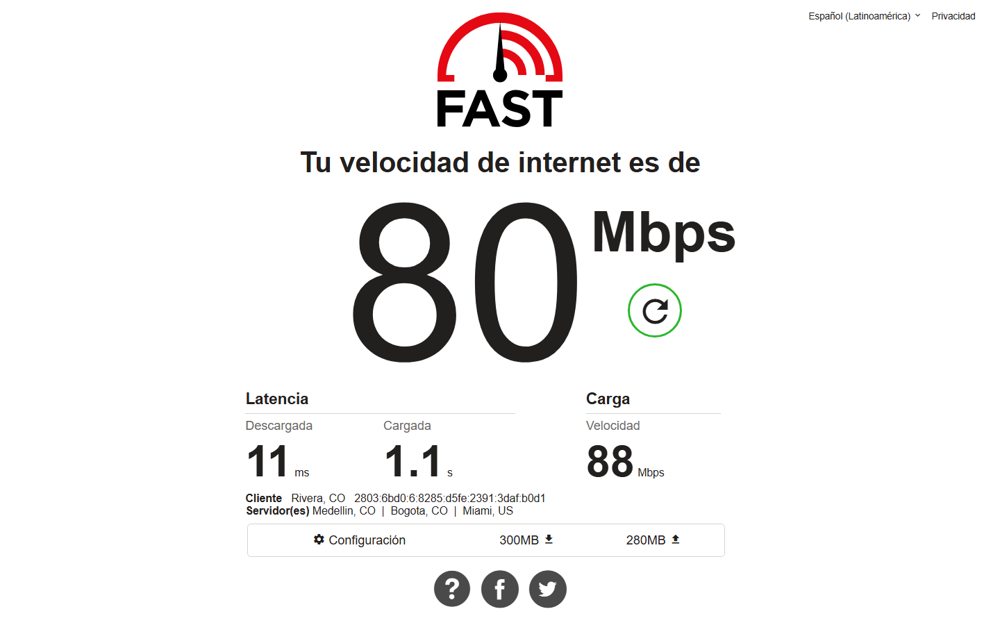
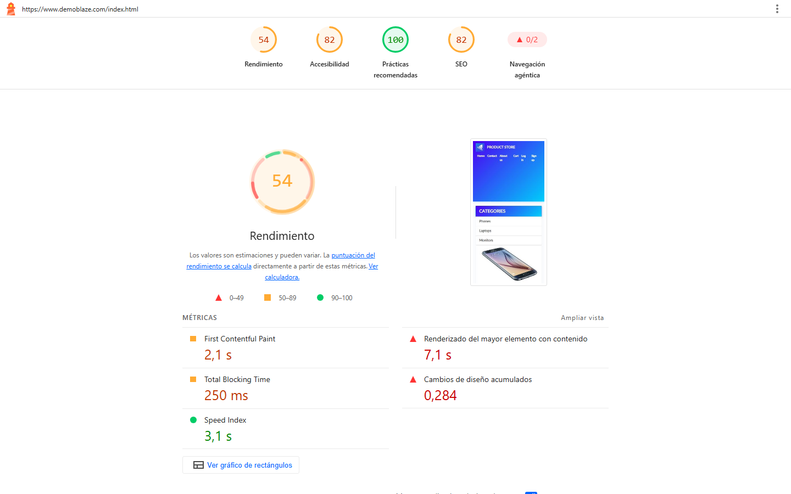
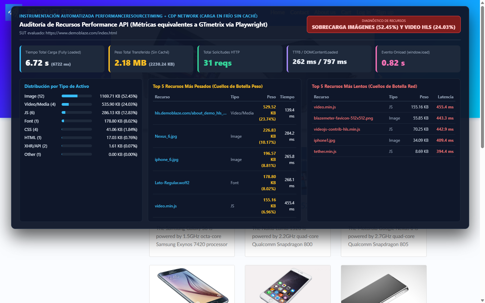
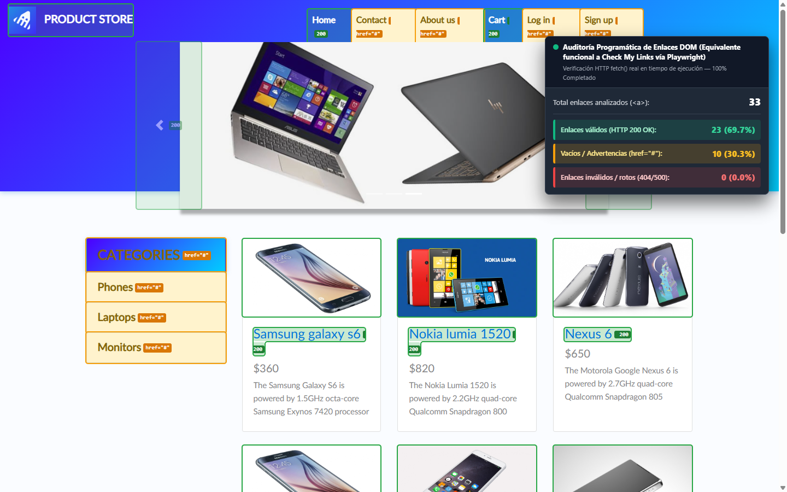
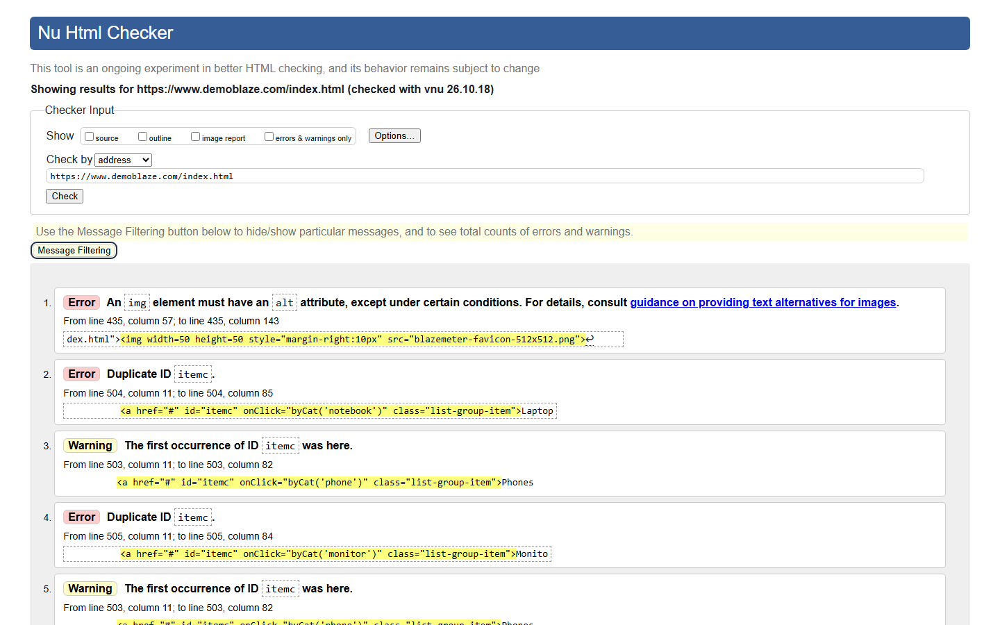
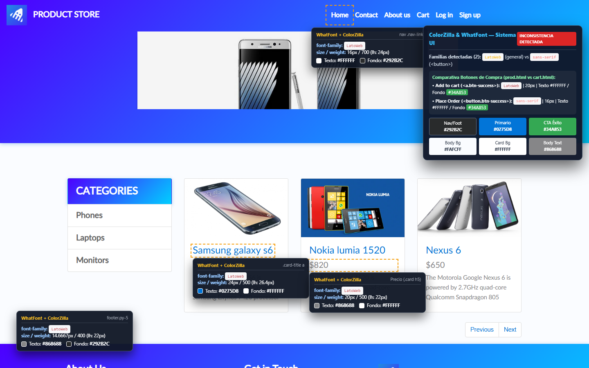

# Reporte Técnico de Auditoría QA con Herramientas Web y Estándares UI (ISO/IEC 25010) — Integrante 2

- **Sistema Bajo Prueba (SUT):** DemoBlaze E-Commerce (`https://www.demoblaze.com/index.html`, `prod.html` y `cart.html`)
- **Marco Taxonómico de Calidad:** ISO/IEC 25010 (*Eficiencia de Desempeño* y *Capacidad de Interacción / Usabilidad*)
- **Responsable:** Integrante 2 — Auditoría con Herramientas de Diagnóstico Web, Estándares W3C e Inspección UI
- **Instrumentación Aplicada:** FAST.com en navegador real, Google Lighthouse CLI v13.5.0 (motor de PageSpeed Insights), instrumentación programática con Playwright sobre `PerformanceResourceTiming` + CDP Network (equivalente funcional a GTmetrix) y sobre nodos `<a>` del DOM con `fetch()` HTTP (equivalente funcional a Check My Links), W3C Nu Html Checker v26.10.18 e inspección computada DOM/CSS (`WhatFont` y `ColorZilla`) en viewport `1440x900`
- **Fecha de Ejecución (UTC):** `2026-10-26T03:42:57Z` – `2026-10-26T03:49:42Z`

> **Nota Metodológica sobre ISO/IEC 25010 y los Límites de Decisión del Estudio:**
> La norma **ISO/IEC 25010** establece exclusivamente el **modelo taxonómico de calidad del producto software** (sus características y subcaracterísticas, tales como *Comportamiento temporal*, *Utilización de recursos*, *Operabilidad*, *Estética de la interfaz de usuario* y *Accesibilidad*), y **no prescribe valores ni umbrales numéricos fijos**. Todos los criterios cuantitativos de aprobación empleados en este reporte (por ejemplo: `Descarga > 30 Mbps`, `Subida > 8 Mbps`, `LCP < 2.5 s`, `CLS < 0.1`, `TBT < 200 ms`, `Puntuación >= 90`, `0 errores HTTP 404`, `0 errores de sintaxis HTML5` y `100% de uniformidad tipográfica`) corresponden a los **parámetros y límites de decisión definidos por el equipo evaluador** con base en los lineamientos de la cátedra y estándares técnicos de referencia en la industria (*Google Core Web Vitals*, *W3C HTML5* y *WCAG 2.1 Nivel AA*).

---

## SECCIÓN 1: Entorno de Pruebas y Validación de Línea Base de Red (Paso 1)

Como control experimental previo a la medición de las subcaracterísticas de *Eficiencia de Desempeño* del modelo **ISO/IEC 25010**, el equipo evaluador caracterizó el hardware, sistema operativo y proveedor de red de la estación de pruebas para verificar que el entorno local no introduzca cuellos de botella de cómputo, latencia parásita ni estrangulamiento de ancho de banda (*bandwidth throttling*).

### 1.1. Especificaciones del Entorno de Pruebas (Hardware, SO y Red)

Datos reales extraídos mediante el módulo `node:os`, consultas CIM/WMI del sistema (`Get-CimInstance Win32_Processor`, `Win32_PhysicalMemory`, `Win32_OperatingSystem`) y verificación pública de enrutamiento BGP/ASN (`https://ipapi.co/json/` e `https://ipinfo.io/json`), respaldados en [`./datos/01_red.json`](./datos/01_red.json):

| Componente del Entorno | Especificación Técnica Real Verificada |
| :--- | :--- |
| **Equipo / Estación de Trabajo** | `LENOVO 83JC` |
| **Procesador (CPU)** | **AMD Ryzen 7 7435HS** — Velocidad base **`3.10 GHz`** (`3,100 MHz` WMI / `3,094 MHz` `os.cpus()`), **`8` núcleos físicos** y **`16` núcleos lógicos** (`x64`) |
| **Memoria RAM** | **`24.00 GB` instalados** (`2 × 12 GB DDR5 @ 4800 MHz`, fabricante Ramaxel Technology; **`23.69 GB`** [`25,439,199,232 bytes`] utilizables por el SO) |
| **Sistema Operativo** | **Microsoft Windows 11 Home Single Language** (`64 bits`), Versión **`26H2`** (`10.0.26300`, Compilación / Build **`26300`**) |
| **Proveedor de Internet (ISP / Org)** | **`NETWORKS TV S.A.S`** — Sistema Autónomo **`AS274223`** (Red IPv6 `2803:6bd0::/32` / IPv4 pública `38.236.106.239`, Huila, Colombia) |
| **Pila de Software de Auditoría** | `Node.js v24.19.0`, `Playwright Chromium` (`1440x900`), `Google Lighthouse CLI v13.5.0`, `W3C Nu Html Checker v26.10.18` |

### 1.2. Resultados Empíricos de Conectividad (Línea Base)

- **Evidencia visual:** [`./capturas/01_speedtest.png`](./capturas/01_speedtest.png)
- **Registro estructurado:** [`./datos/01_red.json`](./datos/01_red.json)

| Parámetro de Red Evaluado | Valor Real Obtenido | Límite de Decisión del Estudio / Criterio de Aceptación | Dictamen |
| :--- | :---: | :---: | :---: |
| **Proveedor de Servicios de Internet (ISP)** | **`NETWORKS TV S.A.S` (`AS274223`)** | Identificación trazable del operador de red | **VERIFICADO** |
| **Ping / Latencia en Reposo (Descargada)** | **`11 ms`** | Estable (`< 100 ms`) | **CUMPLE** |
| **Velocidad de Descarga (Download)** | **`80 Mbps`** (`300 MB` transferidos) | **`> 30 Mbps`** | **CUMPLE** (`2.67x` el mínimo) |
| **Velocidad de Subida (Upload)** | **`88 Mbps`** (`280 MB` transferidos) | **`> 8 Mbps`** | **CUMPLE** (`11.0x` el mínimo) |
| **Latencia bajo Saturación Máxima (Cargada)** | `1.1 s` (`1,100 ms`) | Informativo (*bufferbloat* bajo estrés continuo de `300 MB`) | **INFO** |
| **Ubicación y Nodos de Prueba** | Cliente: `Rivera / Neiva, Huila, CO` | Nodos CDN: `Medellin, CO \| Bogota, CO \| Miami, US` | **INFO** |

### 1.3. Análisis Técnico de Conectividad

1. **Relación entre Subida (`88 Mbps`) y Bajada (`80 Mbps`) e influencia en la carga de activos web:**
   Se observa una diferencia de **`+8 Mbps` (`+10%`)** a favor del enlace de subida sobre la red de **`NETWORKS TV S.A.S (AS274223)`**, comportamiento característico de un acceso de **fibra óptica simétrica (FTTH)** con ligera concurrencia en el canal descendente. En la arquitectura HTTP/1.1 y HTTP/2 de un comercio electrónico como DemoBlaze, la **velocidad de descarga (`80 Mbps` $\approx 10\text{ MB/s}$ teóricos)** gobierna la transferencia de documentos HTML, hojas CSS, paquetes JavaScript, fuentes tipográficas (`.woff2`), fotografías del catálogo (`.jpg`) y segmentos de video (`.ts`). A su vez, disponer de **`88 Mbps` de subida** garantiza que la negociación TCP (`SYN`, `ACK`), el *handshake* TLS 1.3 y las peticiones `GET`/`POST` hacia `api.demoblaze.com` salgan sin encolamiento ascendente.

2. **Significado técnico del Ping (`11 ms`) en la relación solicitud-respuesta:**
   El valor de **`11 ms`** representa el *Round-Trip Time* (RTT) en reposo entre la estación de pruebas y el nodo de borde. Aunque bajo saturación extrema sostenida (`300 MB` continuos) el enrutador doméstico presenta *bufferbloat* (`1.1 s`), la carga completa en frío de DemoBlaze transfiere únicamente **`2.18 MB` (`2,230.24 KB`)**, volumen que un enlace de `80 Mbps` despacha sin saturar las colas de red.

3. **Validación del prerrequisito ambiental del estudio:**
   Con un procesador de `16` hilos lógicos (`AMD Ryzen 7 7435HS`), `24 GB` de RAM DDR5, **`80 Mbps` de descarga** (frente al límite del estudio de `> 30 Mbps`), **`88 Mbps` de subida** (frente a `> 8 Mbps`) y **`11 ms` de latencia**, queda descartado que el entorno cliente sesgue las mediciones del Paso 2.

---

## SECCIÓN 2: Evaluación de Eficiencia de Desempeño (PageSpeed Insights y Auditoría de Recursos)

> **Nota de Transparencia Instrumental (Recursos y Cascada HTTP):** Dado que el portal web público de GTmetrix restringe la ejecución de pruebas al uso de cuentas autenticadas, la recolección de métricas de utilización de recursos y tiempos de carga se ejecutó mediante **instrumentación automatizada en Playwright sobre el DOM, la API estándar `PerformanceResourceTiming` (`window.performance.getEntriesByType('resource')`) y el protocolo Chrome DevTools (`CDP Network.setCacheDisabled: true`)**, emulando las métricas equivalentes de GTmetrix en carga en frío sin caché para garantizar reproducibilidad exacta desde consola. El panel de la captura [`03_gtmetrix_recursos.png`](./capturas/03_gtmetrix_recursos.png) se rotula explícitamente con esta denominación técnica.

### 2.1. Evidencias Recolectadas

- **Evidencia PageSpeed / Lighthouse:** [`./capturas/02_pagespeed.png`](./capturas/02_pagespeed.png) y [`./datos/02_pagespeed.json`](./datos/02_pagespeed.json)
- **Evidencia Auditoría de Recursos Performance API (equivalente funcional a GTmetrix):** [`./capturas/03_gtmetrix_recursos.png`](./capturas/03_gtmetrix_recursos.png) y [`./datos/03_recursos_gtmetrix.json`](./datos/03_recursos_gtmetrix.json)

### 2.2. Tabla Comparativa de Métricas de Eficiencia de Desempeño

| Subcaracterística ISO/IEC 25010 / Categoría | Métrica Evaluada | Valor Real Obtenido | Límite de Decisión del Estudio / Criterio de Aceptación | Dictamen |
| :--- | :--- | :---: | :--- | :---: |
| **Índice Global PSI / Lighthouse** | **Rendimiento (Performance)** | **`54 / 100`** | `>= 90 / 100` Óptimo (`50–89` Requiere mejora \| `< 50` Deficiente) | **NO CUMPLE NIVEL ÓPTIMO** *(Amarillo)* |
| **Índice Global PSI / Lighthouse** | **Accesibilidad** | **`82 / 100`** | `>= 90 / 100` (Criterio de aceptación del estudio) | **REQUIERE MEJORA** *(Amarillo)* |
| **Índice Global PSI / Lighthouse** | **Prácticas Recomendadas** | **`100 / 100`** | `>= 90 / 100` (Criterio de aceptación del estudio) | **CUMPLE** *(Verde)* |
| **Índice Global PSI / Lighthouse** | **SEO** | **`82 / 100`** | `>= 90 / 100` (Criterio de aceptación del estudio) | **REQUIERE MEJORA** *(Amarillo)* |
| **Comportamiento Temporal** | **First Contentful Paint (FCP)** | **`2.13 s`** (`2,127.67 ms` / `2,1 s`) | `< 1.8 s` (Referencia Core Web Vitals) | **REQUIERE MEJORA** |
| **Comportamiento Temporal** | **Largest Contentful Paint (LCP)** | **`7.08 s`** (`7,083.32 ms` / `7,1 s`) | **`< 2.5 s`** (Límite del estudio / Core Web Vitals) | **NO CUMPLE** *(Crítico: `2.83x` sobre el límite)* |
| **Comportamiento Temporal** | **Total Blocking Time (TBT)** | **`248 ms`** (`250 ms`) | `< 200 ms` (Límite del estudio / Lighthouse) | **NO CUMPLE** *(Requiere mejora)* |
| **Capacidad de Interacción / Estabilidad Visual** | **Cumulative Layout Shift (CLS)** | **`0.284`** (`0.2844`) | **`< 0.1`** (Límite del estudio / Core Web Vitals) | **NO CUMPLE** *(Crítico: `2.84x` sobre el límite)* |
| **Comportamiento Temporal** | **Speed Index (SI)** | **`3.14 s`** (`3,138.23 ms` / `3,1 s`) | `< 3.4 s` (Referencia Lighthouse) | **CUMPLE** |
| **Comportamiento Temporal** | **Time to Interactive (TTI)** | **`8.13 s`** (`8,125.76 ms` / `8,1 s`) | `< 3.8 s` (Referencia Lighthouse) | **NO CUMPLE** |
| **Comportamiento Temporal (Performance API)** | **TTFB / DOMContentLoaded / Onload** | `262 ms` / `797 ms` / `0.82 s` (`819 ms`) | `< 1.0 s` en respuesta del documento HTML base | **CUMPLE** *(HTML base)* |
| **Comportamiento Temporal (Performance API)** | **Tiempo Total de Carga (Fully Loaded)** | **`6.72 s`** (`6,722 ms`) | `< 3.0 s` (Límite del estudio para catálogo inicial) | **NO CUMPLE** |
| **Utilización de Recursos (Performance API + CDP)** | **Peso Total Transferido (Carga en Frío sin Caché)** | **`2.18 MB`** (`2,230.24 KB` / `2,283,764 B`) | `< 1.6 MB` recomendado para vista inicial sin interacción | **NO CUMPLE** *(Sobrecarga multimedia)* |
| **Utilización de Recursos (Performance API + CDP)** | **Número Total de Solicitudes HTTP** | **`31 solicitudes HTTP`** | `< 50 solicitudes` | **CUMPLE** |

### 2.3. Evaluación del LCP (`7.08 s`) y su Incidencia en SEO y Experiencia de Usuario (UX)

El **Largest Contentful Paint (LCP)** registrado alcanza **`7.08 s` (`7,1 s` en interfaz)**, excediendo en **`+4.58 segundos`** (`+183%`) el límite de decisión de **`2.5 segundos`** establecido por el equipo evaluador conforme a *Google Core Web Vitals*. Esta desviación reduce la calificación del indicador a `score: 0.05` y explica la puntuación global de Rendimiento de **`54/100`**.

- **Impacto directo en SEO:** Los motores de búsqueda utilizan *Core Web Vitals* (`LCP < 2.5 s`, `CLS < 0.1`, `INP < 200 ms`) como factor de posicionamiento (*Page Experience*). Un `LCP = 7.08 s` combinado con `CLS = 0.284` ubica la tienda en el umbral **"Deficiente"**, penalizando su indexación competitiva.
- **Impacto en UX y abandono:** Retrasar más de `7 segundos` el renderizado de las tarjetas principales del catálogo genera percepción de bloqueo (*blank grid*) e incrementa la tasa de rebote. Adicionalmente, el **`CLS = 0.284`** desplaza verticalmente el contenido cuando las imágenes terminan de decodificarse sin dimensiones reservadas (`width`/`height`), propiciando clics accidentales.

### 2.4. Identificación Técnica de los Cuellos de Botella de Recursos (Cálculo Unificado en Frío sin Caché)

Todas las proporciones de peso que se reportan a continuación fueron medidas en **carga en frío con caché de navegador deshabilitada (`CDP Network.setCacheDisabled = true`)**, tomando como único denominador exacto el **peso total transferido de la página: `2,283,764 bytes` (`2,230.24 KB` = `2.18 MB`)** en `31` solicitudes HTTP (ver [`03_recursos_gtmetrix.json`](./datos/03_recursos_gtmetrix.json)). El análisis descarta cuellos de botella en la API JSON (`api.demoblaze.com/entries` transfiere solo `1,261 bytes` [`1.23 KB`], sumando `1.61 KB` [`0.07%`] toda la categoría `XHR/API`) e identifica tres causas raíz en el frontend:

1. **Precarga innecesaria de streaming de video HLS para un modal oculto (`24.03%` del peso total transferido de la página):**
   - Sin que el usuario abra el modal *"About us"* (`#videoModal`), la carga inicial descarga automáticamente **`548,764 bytes` (`535.90 KB`)** en `4` solicitudes de tipo `Video/Media`, lo que representa exactamente el **`24.03%`** del peso total transferido de la página ($\frac{548{,}764\text{ B}}{2{,}283{,}764\text{ B}} \times 100 = 24.03\%$).
   - Este flujo multimedia está compuesto por el segmento de video **`hls.demoblaze.com/about_demo_hls_600k00000.ts` (`542,224 bytes` / `529.52 KB`, equivalente al `23.74%` del total de la página y recurso individual más pesado del sitio)** más los dos manifiestos HLS `.m3u8` (`6,540 bytes` / `6.39 KB`, `0.29%`).
   - De forma independiente, dentro de las categorías `JS` (`286.13 KB` totales, `12.83%`) y `CSS` (`41.06 KB` totales, `1.84%`), la página descarga de manera síncrona las librerías del reproductor **`video.min.js` (`158,881 bytes` / `155.16 KB`, `6.96%` del sitio y recurso más lento con `455.4 ms`)**, **`videojs-contrib-hls.min.js` (`71,938 bytes` / `70.25 KB`, `3.15%`, `442.9 ms`)** y **`video-js.min.css` (`12,084 bytes` / `11.80 KB`, `0.53%`)**, contribuyendo al bloqueo del hilo principal (`TBT = 248 ms`).
2. **Imágenes de catálogo y marca sin formatos modernos (WebP/AVIF), sin compresión ni `loading="lazy"` (`1,197,788 bytes` / `1,169.71 KB` — `52.45%` del peso total en `12` solicitudes):**
   - Fotografías como **`Nexus_6.jpg` (`226.83 KB`, `10.17%`, `284.2 ms`)** e **`iphone_6.jpg` (`196.57 KB`, `8.81%`, `265.8 ms`)** se transfieren en JPEG sin adaptar a la resolución real de `.card`. Asimismo, el logotipo **`blazemeter-favicon-512x512.png` (`55.85 KB`, `443.3 ms`)** descarga un PNG de `512x512 px` para mostrarse a `50x50 px`.
3. **Encadenamiento secuencial de peticiones (*Waterfall Chaining*) y tipografía sin `font-display: swap`:**
   - La fuente **`Lato-Regular.woff2` (`183,088 bytes` / `178.80 KB`, `8.02%` del peso total, `268.1 ms`)** carece de `font-display: swap`. Paralelamente, las imágenes del catálogo recién inician su descarga en el milisegundo `1,221.7 ms` (tras completarse los scripts bloqueantes y la respuesta de `api.demoblaze.com/entries`), postergando el LCP hasta `7.08 s`.

---

## SECCIÓN 3: Evaluación de Integridad de Enlaces (Auditoría Programática DOM / Check My Links)

> **Nota de Transparencia Instrumental (Auditoría de Enlaces):** Dado que en modo automatizado sin perfil persistente no se ejecuta la extensión empaquetada de Chrome Web Store, la auditoría se realizó mediante **instrumentación automatizada en Playwright sobre la totalidad de etiquetas `<a>` del DOM hidratado y verificación HTTP real con `fetch(..., { cache: 'no-store' })`**, emulando la lógica de clasificación y resaltado cromático de *Check My Links* para garantizar reproducibilidad en consola. El panel superpuesto en [`04_check_my_links.png`](./capturas/04_check_my_links.png) se identifica explícitamente como **`Auditoría Programática de Enlaces DOM (Equivalente funcional a Check My Links vía Playwright)`**.

### 3.1. Conteo Exacto y Criterios de Aceptación de Hipervínculos en `index.html`

- **Evidencia visual:** [`./capturas/04_check_my_links.png`](./capturas/04_check_my_links.png)
- **Registro estructurado:** [`./datos/04_enlaces.json`](./datos/04_enlaces.json)

| Clasificación de Hipervínculos | Indicador Visual | Cantidad Exacta | Porcentaje | Límite de Decisión del Estudio / Criterio de Aceptación | Dictamen |
| :--- | :---: | :---: | :---: | :--- | :---: |
| **Total enlaces analizados (`<a>`)** | — | **`33`** | **`100.0%`** | Cobertura del `100%` de nodos `<a>` con catálogo renderizado | **COMPLETO** |
| **Enlaces válidos (`HTTP 200 OK`)** | **Verde** | **`23`** | **`69.7%`** | Respuesta satisfactoria `200 OK` en rutas de navegación reales (`index.html`, `cart.html`, carrusel y `18` enlaces `prod.html?idp_=1..9`) | **CUMPLE** |
| **Enlaces vacíos / Advertencias (`href="#"`)** | **Amarillo** | **`10`** | **`30.3%`** | `0` anclas vacías `href="#"` empleadas como falsos botones que degraden la navegación | **NO CUMPLE** |
| **Enlaces inválidos / Rotos (`HTTP 404 / 500`)** | **Rojo** | **`0`** | **`0.0%`** | **`0` enlaces rotos `HTTP 404 / 500` permitidos** | **CUMPLE** |

### 3.2. Análisis de Códigos HTTP e Impacto en la Subcaracterística de Operabilidad (ISO/IEC 25010)

- **Cumplimiento del límite de decisión sobre enlaces rotos (`0` errores `HTTP 404`):** Los `23` hipervínculos con destino real respondieron con **`HTTP 200 OK`**, descartando enlaces huérfanos hacia fichas de producto (`prod.html?idp_=X`) o carrito (`cart.html`).
- **Afectación a la Operabilidad por el uso de `href="#"` (`10` enlaces, `30.3%`):**
  Seis controles de barra superior (`Contact`, `About us`, `Log in`, `Log out`, `#nameofuser`, `Sign up`) y cuatro del menú lateral (`CATEGORIES`, `Phones`, `Laptops`, `Monitors` con `onClick="byCat(...)"`) utilizan `<a href="#">` en vez de `<button type="button">` o parámetros de ruta (`?cat=notebook`). Esto deteriora la subcaracterística **Operabilidad** en cuatro frentes:
  1. **Salto involuntario al tope (*scroll-to-top*):** Al omitir `event.preventDefault()`, hacer clic en cualquier categoría muta la URL a `index.html#` y desplaza bruscamente la vista al inicio del documento.
  2. **Ruptura de apertura en nueva pestaña:** *"Abrir enlace en una pestaña nueva"* sobre `Laptops` carga `index.html#` sin aplicar el filtro seleccionado.
  3. **Pérdida de historial de navegación:** El botón *Atrás* del navegador no restituye la categoría previamente filtrada.
  4. **Ambigüedad semántica asistiva:** Presenta como hipervínculos de cambio de página elementos cuya acción real es abrir un modal o mutar estado local vía JavaScript.

---

## SECCIÓN 4: Auditoría de Estándares de Código HTML (Validador W3C) e Inspección Semántica de ``

### 4.1. Clasificación de Errores (`Error`) y Advertencias (`Warning`) en W3C

- **Evidencia visual:** [`./capturas/05_w3c_validator.png`](./capturas/05_w3c_validator.png)
- **Registro estructurado:** [`./datos/05_w3c.json`](./datos/05_w3c.json)

El servicio oficial **W3C Nu Html Checker (`v26.10.18`)** reportó **`11` hallazgos** sobre el documento estático `https://www.demoblaze.com/index.html`: **`7` Errores (`Error`)** y **`4` Advertencias (`Warning`)**, incumpliendo el límite de decisión del estudio (`0 errores críticos de sintaxis o estructura HTML5`).

| # | Severidad W3C | Ubicación Exacta | Regla / Mensaje Oficial W3C | Fragmento HTML Afectado |
| :-: | :---: | :--- | :--- | :--- |
| 1 | **`Error`** | Línea `384`, col `15–63` | `The value of the "for" attribute of the "label" element must be the ID of a non-hidden form control.` | `<label for="log-name" class="form-control-label">Username:</label>` *(el input real tiene `id="loginusername"`)* |
| 2 | **`Error`** | Línea `388`, col `15–63` | `The value of the "for" attribute of the "label" element must be the ID of a non-hidden form control.` | `<label for="log-pass" class="form-control-label">Password:</label>` *(el input real tiene `id="loginpassword"`)* |
| 3 | **`Error`** | Línea `392`, col `15–75` | `The value of the "for" attribute of the "label" element must be the ID of a non-hidden form control.` | `<label for="log-pass" id="errorl" class="form-control-label"></label>` |
| 4 | **`Error`** | Línea `435`, col `57–143` | `An "img" element must have an "alt" attribute, except under certain conditions.` | `` *(Navbar `#nava`)* |
| 5 | **`Error`** | Línea `504`, col `11–85` | `Duplicate ID "itemc".` | `<a href="#" id="itemc" onClick="byCat('notebook')" class="list-group-item">Laptops</a>` |
| 6 | **`Error`** | Línea `505`, col `11–84` | `Duplicate ID "itemc".` | `<a href="#" id="itemc" onClick="byCat('monitor')" class="list-group-item">Monitors</a>` |
| 7 | **`Error`** | Línea `555`, col `17–103` | `An "img" element must have an "alt" attribute, except under certain conditions.` | `` *(Footer `#fotcont`)* |
| 8 | **`Warning`** | Línea `303`, col `11–57` | `This document has heading elements but none of them has a computed heading level of 1.` | Ausencia global de etiqueta `<h1>` (salta directamente a `<h4>`/`<h5>`) |
| 9–10 | **`Warning`** | Línea `503`, col `11–82` | `The first occurrence of ID "itemc" was here.` *(x2 referencias)* | `<a href="#" id="itemc" onClick="byCat('phone')" class="list-group-item">Phones</a>` |
| 11 | **`Warning`** | Línea `529`, col `3–51` | `The "type" attribute is unnecessary for JavaScript resources.` | `` |

### 4.2. Inspección Exacta del Atributo `alt` frente a `alt=""` en las `14` Etiquetas `` del DOM

Para evitar confundir la **ausencia sintáctica del atributo `alt`** con la **declaración de cadena vacía `alt=""`**, se inspeccionaron programáticamente las **`14` etiquetas ``** presentes en el DOM renderizado de `https://www.demoblaze.com/index.html` (respaldado en [`05_w3c.json`](./datos/05_w3c.json)):

| Estado Técnico del Atributo `alt` | Cantidad Exacta (`n = 14`) | Porcentaje | Elementos Específicos en el DOM | Evaluación Sintáctica W3C vs. Semántica WCAG 2.1 |
| :--- | :---: | :---: | :--- | :--- |
| **Sin atributo `alt` en absoluto (`!hasAttribute('alt')`)** | **`2`** | **`14.29%`** | Logotipos `blazemeter-favicon-512x512.png` en `a#nava` (línea `435`) y `div#fotcont` (línea `555`) | **Error de sintaxis HTML5 en W3C** (Errores #4 y #7) e incumplimiento de **WCAG 1.1.1**. |
| **Con atributo vacío `alt=""` (cadena vacía)** | **`9`** | **`64.29%`** | Las `9` fotografías de productos del catálogo (`#tbodyid .card img.card-img-top.img-fluid`), inyectadas por `js/index.js` como `` | **Sintácticamente válido para W3C**, pero **mala práctica semántica grave de accesibilidad (WCAG 1.1.1 y 2.4.4)** al ocultar imágenes informativas de producto y dejar mudos sus enlaces `<a href="prod.html?idp_=...">`. |
| **Con atributo `alt` no vacío genérico de plantilla** | **`3`** | **`21.43%`** | Los `3` banners del carrusel promocional (`.carousel-item img`: `Samsung1.jpg`, `nexus1.jpg`, `iphone1.jpg`) con `alt="First slide"`, `"Second slide"` y `"Third slide"` | **Sintácticamente válido para W3C**, pero **semánticamente deficiente (WCAG 1.1.1)** al mantener el texto de relleno de Bootstrap sin identificar el producto promocionado. |

- **Explicación técnica sobre `alt=""` (cadena vacía) en contenido comercial:** En HTML5, el atributo vacío `alt=""` está reservado exclusivamente para **imágenes puramente decorativas**, indicando a las tecnologías de asistencia que ignoren el nodo gráfico (equivalente a `role="presentation"`). Utilizar `alt=""` en las **`9` fotografías de productos del catálogo** —que sí transmiten información visual esencial para la decisión de compra y que además constituyen el **único contenido hijo de enlaces funcionales `<a href="prod.html?idp_=X">`**— constituye una **mala práctica semántica de accesibilidad (WCAG 2.1 Criterios 1.1.1 y 2.4.4)**: provoca que los lectores de pantalla omitan las fotografías de los artículos y encuentren hipervínculos sin nombre accesible (*empty links*, penalizando el puntaje de Accesibilidad de Lighthouse a `82/100`), aun cuando el Validador HTML W3C no lo reporte como error de sintaxis.

### 4.3. Impacto en Accesibilidad e Interoperabilidad y Protocolo de Reporte a Desarrollo

1. **Impacto adicional de los hallazgos W3C sobre Accesibilidad e Interoperabilidad:**
   - **Formularios sin asociación programática (Errores #1, #2 y #3):** En `#logInModal`, los `<label>` apuntan a `log-name` y `log-pass` mientras que los `<input>` reales usan `id="loginusername"` e `id="loginpassword"`, impidiendo el enfoque al hacer clic en la etiqueta y dejando los campos sin descripción en lectores de pantalla (NVDA, JAWS, VoiceOver).
   - **Colisión de identificadores en el DOM (Errores #5 y #6):** Triplicar `id="itemc"` en las tres categorías provoca que `document.getElementById('itemc')` retorne únicamente el primer nodo (`Phones`), rompiendo selectores únicos y referencias ARIA.
   - **Ausencia de encabezado principal `<h1>` (Warning #8):** Impide identificar la jerarquía temática primaria del documento.
2. **Protocolo formal de reporte y remediación para desarrollo:**
   - *Líneas `384–392`:* Alinear `for="loginusername"` y `for="loginpassword"`, y sustituir `<label id="errorl">` por `

`.
   - *Líneas `435` y `555` + `js/index.js`:* Añadir `alt=""` únicamente a los íconos decorativos acompañados del texto literal `"PRODUCT STORE"`, actualizar `js/index.js` para inyectar `alt="' + articleItem.title + '"` en las `9` tarjetas de producto, y describir los productos reales en los `3` slides del carrusel.
   - *Líneas `503–505`:* Reemplazar `id="itemc"` duplicado por una clase `.category-item` e identificadores únicos (`id="cat-phone"`, `id="cat-notebook"`, `id="cat-monitor"`).

---

## SECCIÓN 5: Auditoría de Diseño de Interfaces UI y Tipografía (WhatFont y ColorZilla)

### 5.1. Inventario Tipográfico y Paleta Cromática Extraída

- **Evidencia visual:** [`./capturas/06_whatfont_colorzilla.png`](./capturas/06_whatfont_colorzilla.png)
- **Registro estructurado:** [`./datos/06_estilos_ui.json`](./datos/06_estilos_ui.json)

| Componente Evaluado | Vista | Selector / Etiqueta | `font-family` | `font-size` | `font-weight` | `line-height` | Color Texto (`#HEX`) | Color Fondo Efectivo (`#HEX` / Gradiente) |
| :--- | :---: | :--- | :--- | :---: | :---: | :---: | :---: | :--- |
| **Navbar — Marca** | `index.html` | `#nava` (`<a>`) | `LatoWeb` | `20px` | `700` | `30px` | `#FFFFFF` | `#292B2C` + `linear-gradient(135deg, #4C00FF, #00CFFF)` |
| **Navbar — Enlaces** | `index.html` | `nav .nav-link` (`<a>`) | `LatoWeb` | `16px` | `700` | `24px` | `#FFFFFF` | `#292B2C` + `linear-gradient(135deg, #4C00FF, #00CFFF)` |
| **Títulos de Productos** | `index.html` | `.card-title a` (`<a>`) | `LatoWeb` | `24px` | `500` | `26.4px` | `#0275D8` | `#FFFFFF` |
| **Precios en Catálogo** | `index.html` | `.card h5` (`<h5>`) | `LatoWeb` | `20px` | `500` | `22px` | `#868688` | `#FFFFFF` |
| **Descripción Tarjeta** | `index.html` | `.card-text` (`
`) | `LatoWeb` | `14.67px` | `400` | `24px` | `#868688` | `#FFFFFF` |
| **Precio en Detalle** | `prod.html` | `.price-container` (`<h3>`) | `LatoWeb` | `24px` | `300` | `26.4px` | `#292B2C` | `#FFFFFF` |
| **Botón `Add to cart`** | `prod.html` | `a.btn-success` (`<a>`) | `LatoWeb` | `20px` | `400` | `25px` | `#FFFFFF` | `#34A853` |
| **Botón `Place Order`** | `cart.html` | `button.btn-success` (`<button>`) | **`sans-serif`** | **`16px`** | `400` | `20px` | `#FFFFFF` | `#34A853` |
| **Botones de Modales** | `index.html` | `.btn-primary` (`<button>`) | **`sans-serif`** | `16px` | `400` | `20px` | `#FFFFFF` | `#0275D8` |
| **Footer Informativo** | `index.html` | `#fotcont` (`
`) | `LatoWeb` | `14.67px` | `400` | `22px` | `#FFFFFF` | Gradiente azul/violeta sobre `#FAFCFF` |
| **Footer Copyright** | `index.html` | `footer.py-5` (`<footer>`) | `LatoWeb` | `14.67px` | `400` | `22px` | `#868688` | `#292B2C` |

### 5.2. Evaluación del Sistema de Diseño frente a la Subcaracterística de Estética UI (ISO/IEC 25010)

DemoBlaze **no mantiene un sistema de diseño uniforme**, sino una superposición incompleta de **Bootstrap 4 Alpha 6** (`#0275D8` primario, `#292B2C` `bg-inverse`) con reglas parciales de rebranding de BlazeMeter (`LatoWeb`, `#34A853` y gradiente `#4C00FF -> #00CFFF`), incumpliendo los criterios de aceptación del estudio para *Estética de la interfaz de usuario* y *Accesibilidad*:

1. **Fractura tipográfica entre enlaces y botones (`LatoWeb` vs. `sans-serif`):**
   El estilo personalizado asigna `font-family: LatoWeb` al `body`, pero Bootstrap 4 Alpha conserva `font-family: sans-serif` en la etiqueta nativa `<button>`. Por ello, **`Add to cart`** en `prod.html` (`<a class="btn btn-success btn-lg">`) renderiza en **`LatoWeb` a `20px`**, mientras que **`Place Order`** en `cart.html` y los botones de formularios modales (`<button>`) caen al fallback **`sans-serif` a `16px`**, incumpliendo el criterio del estudio de **100% de uniformidad tipográfica**.
2. **Asimetría cromática y de peso en precios:**
   En `index.html`, los precios (`.card h5`) se pintan en gris `#868688` (`20px`, peso `500`), mientras que en `prod.html` cambian a `#292B2C` (`24px`, peso `300`).
3. **Contraste cromático insuficiente frente al criterio industrial WCAG 2.1 Nivel AA (`>= 4.5:1`):**
   El texto gris `#868688` sobre fondo blanco `#FFFFFF` alcanza apenas **`3.63:1`** y el botón de conversión **`Place Order`** (`#FFFFFF` sobre `#34A853` a `16px` regular) registra **`3.05:1`**, ambos por debajo de la relación `4.5:1` de WCAG 2.1 AA adoptada como límite de decisión por el equipo evaluador.

---

## SECCIÓN 6: Tabla Consolidada de Veredicto Preliminar (Integrante 2)

La siguiente matriz sintetiza los resultados empíricos del módulo asociando cada subcaracterística de la taxonomía **ISO/IEC 25010** con el **límite de decisión definido por el equipo evaluador** para su triangulación en el **Paso 4**:

| Característica / Subcaracterística ISO/IEC 25010 | Instrumento Aplicado | Métrica / Indicador Evaluado | Valor Real Obtenido | Límite de Decisión del Estudio / Criterio de Aceptación | Dictamen Final |
| :--- | :--- | :--- | :---: | :--- | :---: |
| **Control Ambiental Previo (Paso 1)** | FAST.com (`1440x900`) + Telemetría `node:os` / WMI / BGP | Hardware, SO, ISP (`NETWORKS TV S.A.S`), Descarga, Subida y Ping | **`Ryzen 7 7435HS` \| `24 GB RAM` \| `Win 11 26H2` \| `80 Mbps` ↓ / `88 Mbps` ↑ / `11 ms`** | `> 30 Mbps` bajada, `> 8 Mbps` subida, Ping `< 100 ms` e ISP identificado | **CUMPLE** |
| **Eficiencia de Desempeño** *(Comportamiento Temporal)* | PageSpeed Insights / Lighthouse v13.5.0 | **Largest Contentful Paint (LCP)** | **`7.08 s`** (`7,1 s`) | **`< 2.5 s`** (Core Web Vitals) | **NO CUMPLE** |
| **Eficiencia de Desempeño** *(Índice Global)* | PageSpeed Insights / Lighthouse v13.5.0 | **Puntuación Global de Rendimiento** | **`54 / 100`** *(Amarillo)* | **`>= 90 / 100`** (Nivel óptimo definido en el estudio) | **NO CUMPLE** *(Requiere mejora)* |
| **Eficiencia de Desempeño / Interacción** *(Estabilidad y Bloqueo)* | PageSpeed Insights / Lighthouse v13.5.0 | **CLS** / **TBT** / **FCP** / **Speed Index** | CLS: **`0.284`** \| TBT: **`248 ms`** \| FCP: **`2.13 s`** \| SI: **`3.14 s`** | `CLS < 0.1`, `TBT < 200 ms`, `FCP < 1.8 s`, `SI < 3.4 s` | **NO CUMPLE** *(Solo aprueba SI)* |
| **Eficiencia de Desempeño** *(Utilización de Recursos)* | Auditoría de Recursos Performance API + CDP (equivalente a GTmetrix) | Carga en frío sin caché: Fully Loaded, Peso Total y Solicitudes HTTP | **`6.72 s`** \| **`2.18 MB`** (`2,230.24 KB`) \| **`31 reqs`** | `< 3.0 s` carga total, `< 1.6 MB` transferidos y `< 50` solicitudes HTTP | **NO CUMPLE** *(52.45% imágenes + 24.03% video HLS oculto)* |
| **Capacidad de Interacción** *(Operabilidad — Enlaces Rotos)* | Auditoría Programática DOM + `fetch()` (equivalente a Check My Links) | Enlaces rotos con respuesta `HTTP 404 / 500` | **`0 enlaces rotos`** (`23/33` con `HTTP 200 OK`) | **`0` enlaces rotos `HTTP 404 / 500` permitidos** | **CUMPLE** |
| **Capacidad de Interacción** *(Operabilidad — Navegación)* | Auditoría Programática DOM + `fetch()` (equivalente a Check My Links) | Anclas vacías o sin destino navegable (`href="#"`) | **`10 enlaces` (`30.3%`) con `href="#"`** | `0` anclas vacías `href="#"` que provoquen saltos de scroll o rompan pestañas | **NO CUMPLE** *(Degrada operabilidad)* |
| **Capacidad de Interacción** *(Accesibilidad e Interoperabilidad)* | W3C Nu Html Checker (`v26.10.18`) + Inspección DOM `` | Sintaxis HTML5 y semántica de alternativas textuales en `14` nodos `` | **`7 Errores` y `4 Warnings` W3C**; en DOM: **`2` `` sin `alt`**, **`9` con `alt=""` vacío** en catálogo y **`3` con `alt` genérico** | **`0` errores de sintaxis HTML5** y textos `alt` descriptivos en imágenes informativas (WCAG 1.1.1) | **NO CUMPLE** |
| **Capacidad de Interacción** *(Estética UI — Sistema de Diseño)* | Inspección Computada CSS (`WhatFont` y `ColorZilla`) | Uniformidad tipográfica y contraste cromático | **`2` fuentes (`LatoWeb` vs `sans-serif` en `<button>`)**, CTAs `20px` vs `16px` y contraste `3.05:1–3.63:1` | **100% de uniformidad tipográfica** y relación de contraste `>= 4.5:1` (WCAG 2.1 AA) | **NO CUMPLE** |
