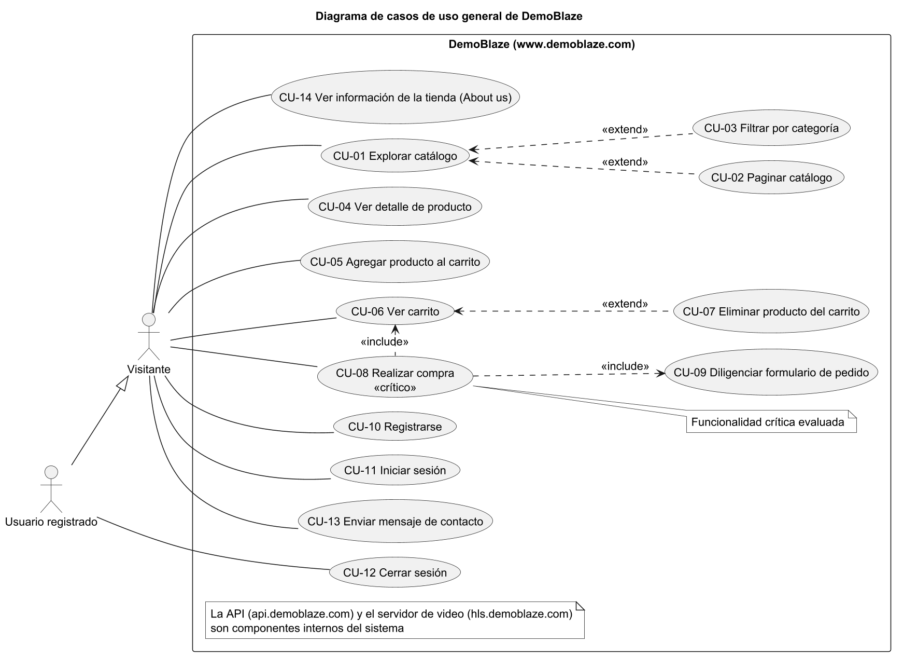
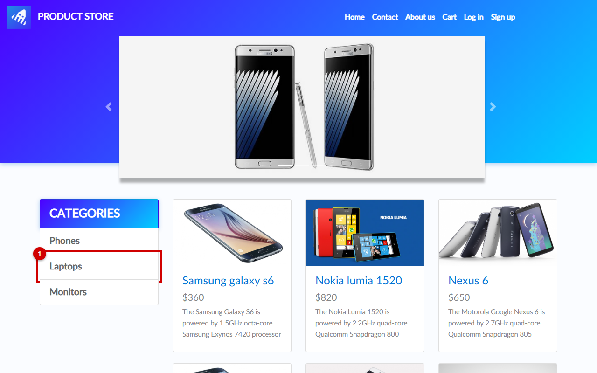
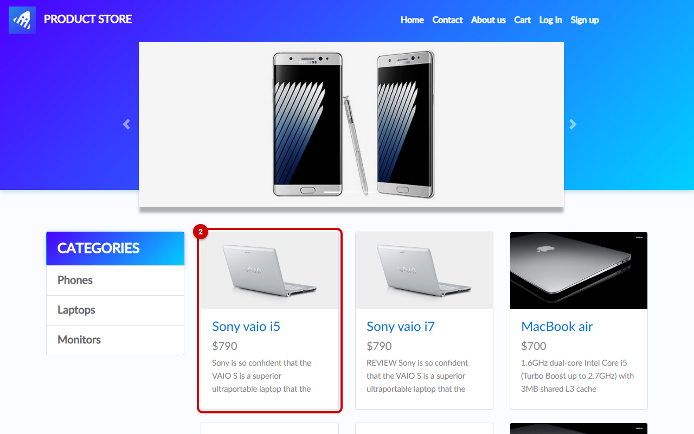
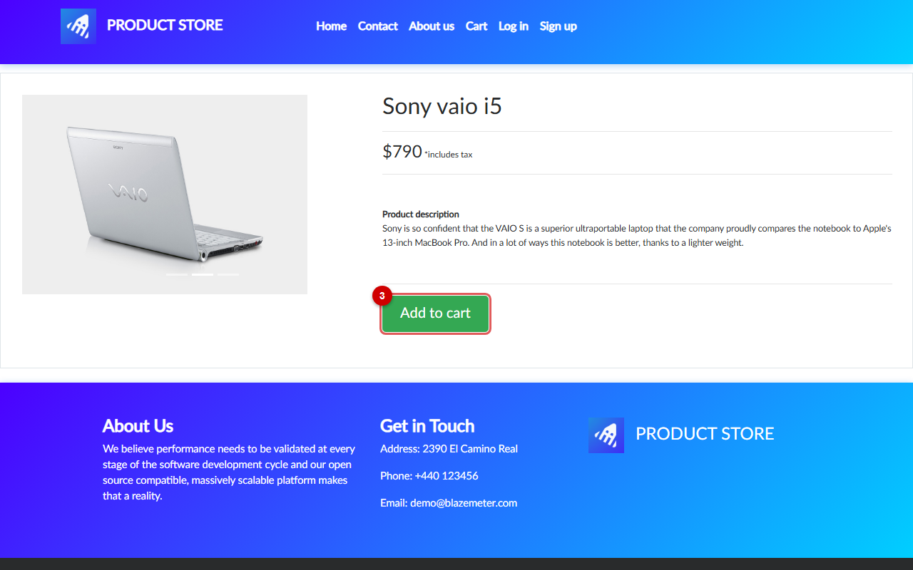
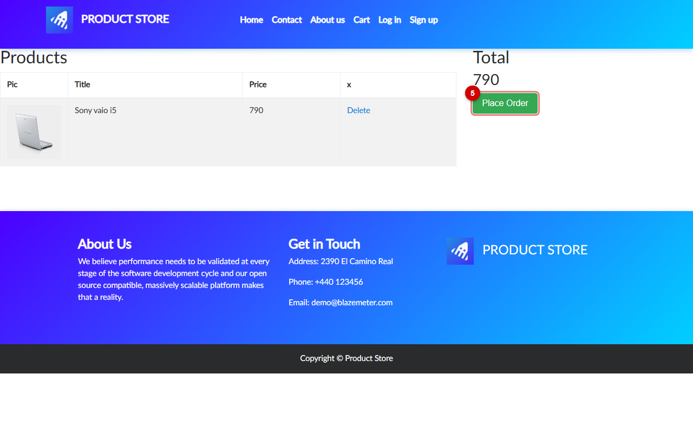
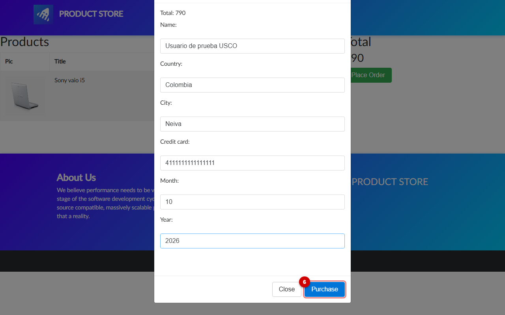
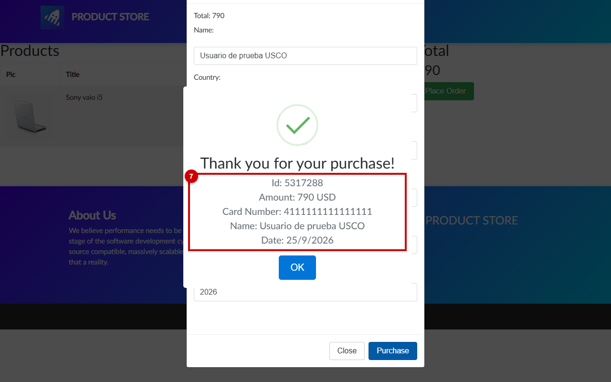

# Evaluación de la calidad del flujo de compra de DemoBlaze según la norma ISO/IEC 25010

Universidad Surcolombiana, Facultad de Ingeniería

Asignatura: Ingeniería de Software Avanzada

Docente: [NOMBRE]

Integrantes:

- [NOMBRE]
- [NOMBRE]
- [NOMBRE]
- [NOMBRE]

Neiva, [FECHA]

## Índice

1. Contextualización y justificación de la funcionalidad
2. Modelado del sistema: casos de uso y pantallas
3. Selección de criterios ISO/IEC 25010 y definición de población y muestra
4. Instrumentos de medición, métricas y parámetros de comportamiento
5. Proceso de evaluación paso a paso
   - Paso 1. Preparación del entorno y línea base
   - Paso 2. Ejecución de herramientas técnicas
   - Paso 3. Aplicación de instrumentos con usuarios
   - Paso 4. Análisis cruzado frente a los parámetros definidos
   - Paso 5. Conclusiones y recomendaciones de mejora
- Referencias
- Anexos

## 1. Contextualización y justificación de la funcionalidad

En este informe evaluamos la calidad de software de la plataforma de comercio electrónico DemoBlaze con base en el estándar internacional ISO/IEC 25010. Para este propósito seleccionamos como funcionalidad crítica el flujo de compra de punta a punta, el cual abarca desde la exploración del catálogo hasta la confirmación de la orden en el modal de pedido. Esta delimitación nos permite examinar las etapas en las que se concentra la interacción del comprador y en las que un fallo impide o entorpece completar la compra.

### 1.1. Descripción de DemoBlaze

DemoBlaze es una tienda en línea de demostración de productos de tecnología. La propia BlazeMeter la presenta como uno de sus sitios de demostración y la usa en sus tutoriales de pruebas de carga (Panetti, 2023). La página principal (https://www.demoblaze.com/index.html) se titula STORE (`04_informe_final/evidencias/recorrido_sitio.json`, paso 1) y muestra en la barra superior el logotipo de BlazeMeter, cargado desde el archivo `blazemeter-favicon-512x512.png` (`01_pruebas_automatizadas_cli/evidencias/03_adecuacion_e_interaccion/integridad_enlaces.json`).

A partir de los registros técnicos recolectados en `04_informe_final/evidencias/recorrido_sitio.json`, constatamos que la plataforma ofrece un catálogo organizado en tres categorías: Phones (7 productos), Laptops (6 productos) y Monitors (2 productos), sumando un inventario total de 15 productos únicos. La vista principal despliega 9 productos iniciales y permite visualizar los 6 restantes en una segunda página mediante los controles de paginación Next y Previous. Cada artículo cuenta con una página de detalle individual (`prod.html?idp_=[id]`) que presenta fotografía, nombre, precio, descripción textual y el botón Add to cart. Al agregar un artículo, este se traslada al carrito de compras (`cart.html`), donde se visualiza una tabla con las columnas Picture, Title, Price y Delete, el valor total acumulado y el botón Place Order para abrir el formulario de facturación.

Adicionalmente, el sistema dispone de módulos complementarios de soporte: autenticación de usuarios mediante modales de registro (Sign up) e inicio de sesión (Log in) con campos de usuario y contraseña, reflejando el estado de la sesión activa en la barra superior con el mensaje Welcome seguido del identificador del usuario, además de la opción de cierre de sesión (Log out). También incorpora un modal de contacto (Contact) con campos para correo electrónico, nombre y mensaje, y un modal informativo institucional (About us) que aloja un reproductor de video sustentado en tecnología de transmisión secuencial HLS.

En contraste con las funciones descritas, identificamos dos ausencias operativas notorias en la experiencia de compra: el sistema carece de un motor o campo de búsqueda por texto (`existeBuscador = false`, con cero entradas de tipo search en el DOM según `04_informe_final/evidencias/recorrido_sitio.json`, paso 1), lo que obliga a explorar el catálogo exclusivamente mediante clics en categorías o paginación, y la vista del carrito no permite modificar cantidades unitarias de un artículo ya agregado (`permiteCambiarCantidadEnCarrito = false`), limitando la gestión a la eliminación completa de la fila. La Tabla 1 sintetiza la estructura funcional observada en el sistema.

Tabla 1. Módulos y funciones observadas en DemoBlaze

| Módulo | Función observada | Evidencia (clave del JSON) |
| :--- | :--- | :--- |
| Catálogo general y paginación | Despliegue de 9 productos en página inicial y 6 en segunda página; navegación mediante botones Next y Previous | `resumenFuncional.productosPorPaginaInicial`, `resumenFuncional.productosEnSegundaPagina`, `pasos[1].observaciones` |
| Clasificación por categorías | Filtrado del inventario en tres familias: Phones (7 productos), Laptops (6 productos) y Monitors (2 productos) | `resumenFuncional.categoriasDisponibles`, `resumenFuncional.productosPorCategoria`, `pasos[2].observaciones` |
| Búsqueda de productos | Ausente; no existen campos de entrada ni selectores con rol o atributo de búsqueda en la interfaz | `resumenFuncional.existeBuscador`, `pasos[0].observaciones.campoBusqueda` |
| Ficha de detalle de producto | Presentación de fotografía, nombre, precio, descripción técnica y botón Add to cart | `pasos[3].observaciones.botonAddToCart`, `pasos[3].observaciones.precioMostrado` |
| Carrito de compras | Tabla con columnas Picture, Title, Price y Delete; cálculo del monto total; sin controles para alterar cantidades unitarias | `resumenFuncional.permiteCambiarCantidadEnCarrito`, `pasos[5].observaciones.columnasTabla` |
| Formulario de pedido | Modal Place Order con seis campos de texto para captura de datos personales y tarjeta de crédito | `resumenFuncional.camposPlaceOrder`, `pasos[5].observaciones.modalPlaceOrder` |
| Gestión de usuarios y sesión | Modales de Sign up y Log in; saludo dinámico en barra superior al iniciar sesión y enlace de Log out | `resumenFuncional.camposSignUp`, `resumenFuncional.camposLogIn`, `resumenFuncional.sesionMuestraUsuarioEnBarra`, `pasos[8].observaciones` |
| Atención y contacto | Modal Contact con campos para correo electrónico, nombre del remitente y cuerpo del mensaje | `resumenFuncional.camposContact`, `pasos[6].observaciones.modalContact` |
| Información institucional | Modal About us con reproductor de video en flujo continuo mediante manifiesto HLS | `resumenFuncional.aboutUsContieneVideo`, `pasos[7].observaciones.reproductorVideo` |

Fuente: elaboración propia a partir de `04_informe_final/evidencias/recorrido_sitio.json`.

### 1.2. Arquitectura general observable

La evaluación técnica de DemoBlaze se efectúa bajo una modalidad estricta de caja negra desde la perspectiva del cliente, dado que no poseemos acceso al servidor de aplicaciones, a las bases de datos de respaldo ni al código fuente alojado en el entorno de ejecución remoto. Toda la caracterización arquitectónica se fundamenta en la inspección de peticiones de red, recursos transferidos y cabeceras HTTP documentados en `04_informe_final/evidencias/recorrido_sitio.json`.

A partir de estas evidencias, identificamos tres componentes diferenciados que estructuran la operación del sistema desde el navegador:

1. Frontend estático alojado en www.demoblaze.com: este servidor concentró 138 solicitudes durante el recorrido automatizado (`resumenArquitectura.hostsContactados`), sirviendo los documentos HTML (`index.html`, `prod.html`, `cart.html`), hojas de estilo y scripts del cliente. Entre las librerías externas identificadas en `resumenArquitectura.librerias` figuran jQuery (`node_modules/jquery/dist/jquery.min.js`), el marco de diseño Bootstrap (`node_modules/bootstrap/dist/js/bootstrap.min.js` y su hoja de estilos correspondiente), Tether (`node_modules/tether/dist/js/tether.min.js`), el reproductor Video.js (`node_modules/video.js/dist/video.min.js` y su hoja de estilos), la extensión HLS de Video.js (`node_modules/videojs-contrib-hls/dist/videojs-contrib-hls.min.js`), el complemento visual SweetAlert en el carrito (`node_modules/bootstrap-sweetalert/dist/sweetalert.min.js` y `sweetalert.css`) y los scripts propios de la lógica del cliente (`js/index.js`, `js/cart.js`).

2. Interfaz de programación de aplicaciones (API) en api.demoblaze.com: este servicio atendió 17 solicitudes mediante intercambio asíncrono de objetos JSON (`resumenArquitectura.hostsContactados`), gestionando la entrega del catálogo, la paginación, los filtros de categoría, la información de detalle de los productos, el contenido del carrito (asociado a un identificador que el navegador envía en el campo `cookie` de cada petición) y la autenticación de usuarios.

3. Servidor de transmisión multimedia en hls.demoblaze.com: este servidor recibió 26 solicitudes durante el recorrido (`resumenArquitectura.hostsContactados`), destinadas a la entrega del manifiesto de video (`index.m3u8`) y de los fragmentos de transporte (.ts) del reproductor del modal About us. Estas solicitudes aparecen al cargar cada página, aunque el usuario no abra ese modal (`04_informe_final/evidencias/recorrido_sitio.json`, pasos 6 y 9).

En lo relativo a la infraestructura de entrega, las cabeceras HTTP obtenidas tanto para el documento principal HTML como para los puntos de acceso de la API devuelven textualmente el valor `server: Google Frontend` (`resumenArquitectura.cabecerasDocumento.destacadas.server` y `resumenArquitectura.cabecerasApi.destacadas.server`). Nos abstenemos de atribuir plataformas de computación en la nube o tecnologías internas específicas que dicha cabecera no detalle expresamente.

Durante las inspecciones automatizadas registramos diez puntos de acceso de la API, detallados en la Tabla 2. Los primeros nueve corresponden al recorrido general de exploración (`04_informe_final/evidencias/recorrido_sitio.json`). El décimo servicio, `POST /deletecart`, fue observado al ejecutar la compra en `04_informe_final/evidencias/capturas_flujo.json` (paso 7); en dicha ejecución constatamos que el sistema no transmite ninguna petición de registro de pedido a la API, limitándose a solicitar el vaciado del carrito mediante dicho punto de acceso.

Tabla 2. Servicios de la API observados durante el recorrido

| Método | Ruta | Función observada | Paso del recorrido |
| :--- | :--- | :--- | :--- |
| GET | `/entries` | Obtención del catálogo general de productos disponibles | Pasos 1 y 9 |
| POST | `/pagination` | Consulta de productos para la paginación del catálogo | Paso 2 |
| POST | `/bycat` | Filtrado de productos según la categoría seleccionada | Pasos 3 y 4 |
| POST | `/view` | Consulta de los datos detallados de un producto específico | Pasos 4 y 6 |
| POST | `/addtocart` | Adición de un producto al carrito; el cuerpo incluye el identificador del producto y el campo `cookie` del usuario | Paso 5 |
| POST | `/viewcart` | Recuperación de los artículos almacenados en el carrito activo | Paso 6 |
| POST | `/deletecart` | Vaciado de los productos del carrito activo tras pulsar Purchase; no se envía una orden a la API | Capturas, paso 7 |
| POST | `/signup` | Registro de una nueva cuenta de usuario en el sistema | Paso 9 |
| POST | `/login` | Validación de credenciales y apertura de sesión de usuario | Paso 9 |
| POST | `/check` | Envío del token de sesión tras iniciar sesión; interpretamos que verifica la autenticación | Paso 9 |

Fuente: elaboración propia a partir de `04_informe_final/evidencias/recorrido_sitio.json` y `04_informe_final/evidencias/capturas_flujo.json`.

### 1.3. Propósito y público objetivo

Para encuadrar adecuadamente la evaluación de calidad, diferenciamos el propósito operativo real de DemoBlaze de la experiencia comercial simulada en su interfaz. En la realidad, DemoBlaze es uno de los sitios de demostración de BlazeMeter, empresa de herramientas de pruebas de software, que lo usa en sus propios tutoriales como objetivo de pruebas de carga (Panetti, 2023). Detrás de la tienda no hay inventario físico, despachos ni cobros reales.

En su propósito simulado, DemoBlaze emula una tienda minorista en línea dirigida a consumidores interesados en la adquisición de dispositivos electrónicos (teléfonos inteligentes, computadores portátiles y monitores de escritorio). Para los efectos metodológicos de esta evaluación bajo la norma ISO/IEC 25010, definimos como usuario de referencia a un comprador potencial en línea que interactúa con la interfaz buscando adquirir productos de tecnología. Evaluar el sistema desde la perspectiva de este perfil resulta indispensable, pues las expectativas de operabilidad, confianza y protección contra errores corresponden a las de un usuario que pretende realizar una compra digital.

### 1.4. Funcionalidad crítica: flujo de compra de punta a punta

Delimitamos el flujo de compra de punta a punta como la secuencia transaccional que un usuario debe completar para seleccionar un producto y formalizar su pedido en DemoBlaze. A partir de los pasos auditados en `04_informe_final/evidencias/recorrido_sitio.json`, el recorrido evaluado comprende los siguientes seis pasos:

1. Selección de categoría: el usuario ingresa a la página de inicio y hace clic en una de las opciones del panel de categorías (Phones, Laptops o Monitors) para acotar el catálogo. En este paso interviene el servicio de la API `POST /bycat` (`04_informe_final/evidencias/recorrido_sitio.json`, paso 3).

2. Selección y apertura del producto: el usuario examina los productos listados y hace clic sobre el título del artículo de su interés (por ejemplo, Sony vaio i5), navegando a la página de detalle en `prod.html?idp_=8`. En este paso interviene el servicio de la API `POST /view` (`04_informe_final/evidencias/recorrido_sitio.json`, paso 4).

3. Adición al carrito: en la vista de detalle, el usuario pulsa el botón Add to cart y acepta el diálogo modal nativo del navegador con el texto "Product added". En este paso interviene el servicio de la API `POST /addtocart` (`04_informe_final/evidencias/recorrido_sitio.json`, paso 5).

4. Revisión del carrito de compras: el usuario hace clic en el enlace Cart de la barra superior para dirigirse a `cart.html`, visualizando la tabla de productos seleccionados y el cálculo del total acumulado. En este paso intervienen los servicios de la API `POST /viewcart` y `POST /view` (`04_informe_final/evidencias/recorrido_sitio.json`, paso 6).

5. Despliegue y diligenciamiento del modal de pedido: el usuario presiona el botón Place Order para abrir el formulario modal `#orderModal` y procede a diligenciar los campos de datos personales y de pago (Name, Country, City, Credit card, Month y Year). No se observó intervención de servicios de la API en el despliegue del modal ni en la captura de campos (`04_informe_final/evidencias/recorrido_sitio.json`, paso 6).

6. Confirmación de la orden y obtención del comprobante: el usuario hace clic en el botón Purchase para formalizar el pedido y recibe en pantalla una ventana emergente de SweetAlert con el identificador de la compra, el monto, el número de tarjeta, el nombre del comprador y la fecha (`01_pruebas_automatizadas_cli/evidencias/03_adecuacion_e_interaccion/pruebas_funcionales_y_errores.json`). Al ejecutar esta acción observamos que el sistema no envía ningún pedido a la API, sino que efectúa una solicitud `POST /deletecart` para vaciar el carrito activo (`04_informe_final/evidencias/capturas_flujo.json`, paso 7) y genera el comprobante directamente en el navegador del cliente.

Seleccionamos este flujo como la funcionalidad crítica del software porque constituye el núcleo transaccional sobre el cual reposa el modelo de negocio del comercio electrónico: es la única secuencia capaz de convertir una visita en una venta. Si este recorrido presenta fallos de diseño, desorientación o bloqueos de interacción, el usuario interrumpe la navegación y abandona el sitio. Asimismo, las evidencias técnicas preliminares señalan que en este trayecto se concentran los defectos de usabilidad y protección de datos más sensibles de la plataforma.

### 1.5. Justificación de negocio

El abandono del carrito es uno de los problemas mejor documentados del comercio electrónico. Baymard Institute (2025) promedia 50 estudios y calcula una tasa de abandono del carrito del 70,22 %; es decir, cerca de 7 de cada 10 carritos se abandonan sin completar la compra. Cuando se excluye a quienes solo estaban mirando, la misma fuente reporta que el 19 % de los compradores abandonó porque no confió en el sitio con los datos de su tarjeta, el 17 % porque el sitio tuvo errores o se cayó y otro 17 % porque el proceso de pago era demasiado largo o complicado. Baymard Institute (2025) también señala que el checkout promedio en Estados Unidos muestra 23,48 elementos de formulario, cuando un flujo ideal puede tener entre 12 y 14, y estima que el sitio grande promedio podría aumentar su tasa de conversión en un 35,26 % con un mejor diseño del proceso de pago.

Sobre los formularios de pago, Scott (2024) reporta que el 31 % de los sitios evaluados en el estudio comparativo de Baymard no ofrece validación en línea, y advierte que mostrar los errores solo cuando el usuario intenta enviar el formulario puede conducir al abandono. En las pruebas de ese estudio, un participante que invirtió dos dígitos de su tarjeta pudo corregirlos antes de continuar porque el sitio validaba el número en línea con el algoritmo de Luhn. Sobre la retroalimentación al agregar productos, Laubheimer (2018), en un artículo de Nielsen Norman Group, recuerda que agregar el producto al carrito es el primer paso de la compra y que una confirmación clara da al usuario sensación de control. Recomienda además un indicador numérico visible sobre el ícono del carrito, y relaciona esta práctica con dos heurísticas de usabilidad: visibilidad del estado del sistema y prevención de errores.

En Colombia, la Cámara Colombiana de Comercio Electrónico (2025) reportó para el primer trimestre de 2025 ventas en línea por 27,3 billones de pesos y 131,6 millones de transacciones. El mismo informe señala que Tecnología fue la categoría más dinámica, con un 42,6 % de participación, y que las tarjetas de crédito y débito dominaron los medios de pago, con más del 60 % de participación. Estas cifras muestran que un catálogo de tecnología pagado con tarjeta, como el que simula DemoBlaze, corresponde a un tipo de compra frecuente en el país.

Al contrastar la evidencia teórica con los hallazgos técnicos registrados en DemoBlaze, observamos que las deficiencias del sistema se alinean con las principales causas documentadas de abandono:

1. Desprotección crítica en el formulario de pago: en `01_pruebas_automatizadas_cli/evidencias/03_adecuacion_e_interaccion/pruebas_funcionales_y_errores.json` se documenta que el modal Place Order procesa una compra con un número de tarjeta compuesto solo por letras (`TARJETA_FALSA_SIN_NUMEROS_ABC`) y con Country, City, Month y Year vacíos. Los seis campos del formulario son entradas de texto sin atributos HTML5 de validación (`required`, `pattern`, `inputmode`) ni límites de longitud, y el número de tarjeta no se verifica con el algoritmo de Luhn. Inferimos que emitir un comprobante exitoso ante datos de pago claramente inválidos afecta la confianza del comprador, que es justamente la causa de abandono que Baymard Institute (2025) asocia al 19 % de los casos.

2. Retroalimentación deficiente y efímera en la adición de artículos: al pulsar Add to cart, el sistema dispara un diálogo nativo bloqueante (`window.alert("Product added")`), tras cuyo cierre no subsiste ninguna indicación visual en la pantalla y el enlace Cart de la barra superior mantiene cero indicadores numéricos (`conteoBadgesEnNavbar = 0`, según `pruebas_funcionales_y_errores.json` y `recorrido_sitio.json`). Esta deficiencia va en contra de la recomendación de Laubheimer (2018) sobre la visibilidad del estado del sistema, y obliga al comprador a abrir otra vista solo para comprobar si su selección quedó registrada.

3. Ausencia de buscador y rigidez en el carrito: la falta de una barra de búsqueda por texto (`conteoInputTypeSearch = 0` en `pruebas_funcionales_y_errores.json`) impone la exploración secuencial del catálogo, y la tabla del carrito no provee selectores numéricos para variar unidades (`permiteCambiarCantidadEnCarrito = false`). Inferimos que estas omisiones entorpecen la navegación y la gestión del pedido, sumando fricción innecesaria al proceso de compra.

4. Desfase cronológico en la generación del comprobante: en `pruebas_funcionales_y_errores.json` se evidenció que una compra ejecutada el 24 de octubre de 2026 emitió un comprobante con la fecha `Date: 24/9/2026`, reflejando un mes de retraso. Al examinar el código de `purchaseOrder()` en `04_informe_final/evidencias/recorrido_sitio.json` (paso 6), constatamos que la función construye la cadena del recibo mediante `date.getMonth()` sin sumar 1 para compensar la indexación en base cero de JavaScript (donde octubre equivale a 9). En una tienda real, inferimos que un comprobante con la fecha equivocada podría generar confusión y reclamos, y se sumaría a los errores del sitio que el comprador percibe.

Aclaramos que no afirmamos que DemoBlaze sufra pérdidas financieras directas, pues se trata de un entorno demostrativo. El valor del análisis está en que estos defectos coinciden con causas de abandono documentadas en el comercio electrónico real, y por eso el flujo de compra es el objeto que conviene evaluar.

### 1.6. Alcance de un sitio de demostración

DemoBlaze no sostiene un modelo de negocio comercial, no posee clientes reales y sus órdenes no ejecutan cargos bancarios ni transacciones monetarias efectivas. A pesar de estas condiciones, la plataforma constituye un objeto de estudio idóneo y representativo para aplicar la norma ISO/IEC 25010 por cuatro motivos fundamentales: se encuentra desplegada en un entorno de producción público y accesible mediante protocolo seguro HTTPS (`https://www.demoblaze.com`); reproduce en su totalidad las etapas operativas de un checkout electrónico convencional; es uno de los sitios de demostración que BlazeMeter ofrece y usa para ilustrar pruebas de software (Panetti, 2023); y carece de restricciones de confidencialidad o acuerdos de reserva comercial, lo que hace posible incorporar capturas de pantalla reales, fragmentos de código e inspecciones de red sin alterar la fidelidad documental del informe.

Como hallazgo operativo complementario a las subcaracterísticas evaluadas, observamos en `04_informe_final/evidencias/recorrido_sitio.json` (paso 2) una anomalía funcional en los controles de paginación del catálogo: tras avanzar a la segunda página mediante el botón Next (#next2), hacer clic en el botón Previous (#prev2) no restaura los 9 productos de la primera página (Samsung galaxy s6 a Sony vaio i7), sino que envía el objeto `{"id":"1"}` a la ruta `POST /pagination` y muestra los productos 2 a 10 (Nokia lumia 1520 a Apple monitor 24), alterando la secuencia de navegación del visitante.

## 2. Modelado del sistema: casos de uso y pantallas

Dado que la docente no ha operado directamente la plataforma de comercio electrónico DemoBlaze, en este capítulo modelamos su arquitectura funcional desde la perspectiva del usuario final. Para ello presentamos un diagrama general de casos de uso con su catálogo de interacciones, la especificación completa del caso de uso crítico de compra y la secuencia visual documentada mediante capturas reales del sistema en producción.

### 2.1. Diagrama de casos de uso general

Figura 1. Diagrama de casos de uso general de DemoBlaze

Fuente: elaboración propia en PlantUML a partir de `04_informe_final/evidencias/recorrido_sitio.json`.

El modelado funcional identifica dos actores en el sistema: el Visitante y el Usuario registrado. El Visitante representa a cualquier persona que accede a la tienda sin autenticarse, mientras que el Usuario registrado corresponde a quien creó una cuenta en la plataforma e inició sesión. Entre ambos actores se define una relación de generalización o herencia, de modo que el Usuario registrado puede realizar todas las acciones del Visitante y cuenta además con la función exclusiva de cerrar sesión (CU-12). Conviene precisar que en DemoBlaze es posible completar una compra sin haber iniciado sesión, dado que la aplicación vincula el carrito de compras a un identificador que el navegador envía en el campo cookie dentro del cuerpo de las solicitudes HTTP (`04_informe_final/evidencias/recorrido_sitio.json`, paso 5). Por esta razón, el Visitante se relaciona directamente con el caso de uso transaccional de compra.

Por otra parte, la interfaz de programación de aplicaciones (api.demoblaze.com) y el servidor de transmisión multimedia (hls.demoblaze.com) no figuran como actores en el diagrama. En la notación UML, los actores personifican entidades externas, bien sean usuarios humanos o sistemas independientes, que interactúan con las fronteras del software para obtener valor. Tanto la API como el servidor de video son componentes arquitectónicos internos de la infraestructura de DemoBlaze que atienden solicitudes desde el cliente; por ende, forman parte del sistema modelado y no de los actores que demandan sus servicios.

Las relaciones de inclusión y extensión estructuran la modularidad y dependencia entre los casos de uso. Las relaciones de extensión (`<<extend>>`) representan comportamientos opcionales que condicionan o amplían el flujo de un caso de uso base. En DemoBlaze, CU-02 Paginar catálogo y CU-03 Filtrar por categoría extienden a CU-01 Explorar catálogo, debido a que el usuario puede revisar los primeros nueve artículos de la vista principal sin necesidad de filtrar por categorías ni avanzar entre páginas. De modo análogo, CU-07 Eliminar producto del carrito extiende a CU-06 Ver carrito, pues retirar un artículo constituye una decisión facultativa del comprador. En contraste, las relaciones de inclusión (`<<include>>`) señalan secuencias obligatorias que forman parte indivisible del caso de uso base. Así, CU-08 Realizar compra incluye obligatoriamente a CU-06 Ver carrito, ya que el acceso al botón de pedido exige visualizar la tabla de artículos seleccionados, e incluye a CU-09 Diligenciar formulario de pedido, puesto que la formalización de la orden requiere diligenciar y enviar el formulario modal de facturación.

Dentro de este conjunto funcional, delimitamos CU-08 Realizar compra como el caso de uso crítico evaluado, marcado en el diagrama con el estereotipo `<<crítico>>`, pues sobre él recae la culminación de la transacción comercial de la tienda. La Tabla 3 presenta el catálogo completo de los catorce casos de uso modelados.

Tabla 3. Catálogo de casos de uso

| Código | Caso de uso | Actor principal | Evidencia (paso del recorrido o captura) |
| :--- | :--- | :--- | :--- |
| CU-01 | Explorar catálogo | Visitante | Recorrido del sitio, paso 1; capturas de flujo, captura 1 |
| CU-02 | Paginar catálogo | Visitante | Recorrido del sitio, paso 2 |
| CU-03 | Filtrar por categoría | Visitante | Recorrido del sitio, paso 3; capturas de flujo, captura 2 |
| CU-04 | Ver detalle de producto | Visitante | Recorrido del sitio, paso 4; capturas de flujo, captura 3 |
| CU-05 | Agregar producto al carrito | Visitante | Recorrido del sitio, paso 5; capturas de flujo, captura 4 |
| CU-06 | Ver carrito | Visitante | Recorrido del sitio, paso 6; capturas de flujo, captura 5 |
| CU-07 | Eliminar producto del carrito | Visitante | Recorrido del sitio, paso 6; pruebas funcionales y de errores |
| CU-08 | Realizar compra | Visitante | Capturas de flujo, capturas 6 y 7; pruebas funcionales y de errores |
| CU-09 | Diligenciar formulario de pedido | Visitante | Recorrido del sitio, paso 6; capturas de flujo, captura 6 |
| CU-10 | Registrarse | Visitante | Recorrido del sitio, paso 9 |
| CU-11 | Iniciar sesión | Visitante | Recorrido del sitio, paso 9 |
| CU-12 | Cerrar sesión | Usuario registrado | Recorrido del sitio, paso 9 |
| CU-13 | Enviar mensaje de contacto | Visitante | Recorrido del sitio, paso 7 |
| CU-14 | Ver información de la tienda (About us) | Visitante | Recorrido del sitio, paso 8 |

Fuente: elaboración propia a partir de `04_informe_final/diagramas/casos_de_uso_demoblaze.puml`, `04_informe_final/evidencias/recorrido_sitio.json` y `04_informe_final/evidencias/capturas_flujo.json`.

### 2.2. Especificación del caso de uso crítico "Realizar compra"

A continuación especificamos de forma detallada el caso de uso crítico CU-08 Realizar compra, documentando sus actores, condiciones de ejecución, secuencia transaccional completa y las reglas de negocio verificadas empíricamente en la lógica del cliente y la red.

Tabla 4. Especificación del caso de uso crítico CU-08 Realizar compra

| Elemento | Especificación |
| :--- | :--- |
| Código y nombre | CU-08 Realizar compra |
| Actor principal | Visitante (o Usuario registrado por relación de generalización) |
| Actores secundarios | Ninguno. DemoBlaze no integra pasarelas de pago de terceros, sistemas de validación bancaria ni servicios logísticos externos; la transacción se procesa en el navegador del cliente mediante scripts y llamadas asíncronas a su propia API. |
| Descripción | Permite al usuario revisar los productos agregados al carrito, desplegar el formulario modal de facturación Place Order, registrar datos de pago, confirmar la orden y recibir un comprobante visual en pantalla, regresando a la página de inicio. |
| Precondiciones | El usuario debe encontrarse navegando en la plataforma DemoBlaze y haber incorporado al menos un artículo al carrito de compras mediante CU-05 Agregar producto al carrito. No se requiere autenticación previa. |
| Disparador | Clic en el enlace Cart de la barra superior de navegación. |
| Flujo principal | 1. Acción del actor: Hace clic en el enlace Cart de la barra superior para revisar su selección. 2. Respuesta del sistema: Carga la página `cart.html`, realiza las peticiones `POST /viewcart` y `POST /view` a la API (`04_informe_final/evidencias/capturas_flujo.json`, paso 5) y despliega la tabla con los artículos, sus precios y el total acumulado. 3. Acción del actor: Hace clic en el botón Place Order para abrir el formulario de pago. 4. Respuesta del sistema: Despliega la ventana modal `#orderModal` con los campos Name, Country, City, Credit card, Month y Year. 5. Acción del actor: Diligencia los campos del formulario con sus datos de facturación y hace clic en el botón Purchase. 6. Respuesta del sistema: Ejecuta la función `purchaseOrder()` en el cliente, verifica que Name y Credit card no estén vacíos, invoca la función `deleteCart()` para enviar la petición `POST /deletecart` a la API (`04_informe_final/evidencias/capturas_flujo.json`, paso 7) y muestra una ventana emergente de SweetAlert con el comprobante de confirmación ("Thank you for your purchase!") con Id, Amount, Card Number, Name y Date. 7. Acción del actor: Hace clic en el botón OK del comprobante de confirmación. 8. Respuesta del sistema: Ejecuta la instrucción `location.href = 'index.html'` y redirige al usuario a la página de inicio (`04_informe_final/evidencias/capturas_flujo.json`, paso 7). |
| Flujos alternos | FA-1. Compra con el carrito vacío (el sistema no hace cumplir la precondición): Si el usuario ingresa a `cart.html` sin productos (la tabla muestra cero filas y el total permanece vacío) y pulsa Place Order, el sistema despliega el formulario modal. Al ingresar Name y Credit card y pulsar Purchase, la función `purchaseOrder()` ejecuta la transacción sin validar artículos, envía la petición `POST /deletecart` y genera la confirmación exitosa de SweetAlert con "Amount: 0 USD" (`04_informe_final/evidencias/capturas_flujo.json`, clave `verificacionCarritoVacio`). |
| Flujos de excepción | FE-1. Omisión de campos obligatorios Name o Credit card: Si el actor pulsa Purchase dejando vacío Name, Credit card o ambos, el sistema interrumpe el procesamiento y muestra un diálogo nativo del navegador (`window.alert`) con el mensaje textual "Please fill out Name and Creditcard.", impidiendo avanzar hasta que ambos campos contengan texto (`01_pruebas_automatizadas_cli/evidencias/03_adecuacion_e_interaccion/pruebas_funcionales_y_errores.json`, prueba negativa 1). FE-2. Ingreso de tarjeta alfabética y omisión de datos de ubicación y fecha: Si el actor ingresa texto alfabético en el campo de tarjeta (`TARJETA_FALSA_SIN_NUMEROS_ABC`) y deja vacíos Country, City, Month y Year, el sistema no bloquea el envío. Al hacer clic en Purchase, emite el comprobante exitoso de confirmación, ya que el script del cliente solo comprueba que Name y Credit card no sean cadenas vacías, omitiendo comprobaciones de formato numérico, algoritmo de Luhn o campos secundarios (`01_pruebas_automatizadas_cli/evidencias/03_adecuacion_e_interaccion/pruebas_funcionales_y_errores.json`, prueba negativa 2; `04_informe_final/evidencias/capturas_flujo.json`, clave `codigoFuente.purchaseOrder`). |
| Postcondiciones | El carrito queda vacío tras la petición `POST /deletecart` (al volver a `cart.html` la tabla muestra cero filas, según la clave `verificacionCarritoVacio`). El usuario recibe en pantalla un comprobante con identificador numérico y resumen de compra. El navegador es redirigido a `index.html`. Como el cliente no envía los datos del pedido a ningún servicio, desde lo observable la orden no queda registrada en ninguna parte. |
| Reglas de negocio observadas | 1. Identificador de compra pseudoaleatorio: El Id del comprobante se genera de manera local en el cliente mediante la expresión `Math.floor((Math.random() * 10000000) + 1)`, asignando un número entero entre 1 y 10.000.000 sin consultar al servidor, por lo que nada garantiza que no se repita (`04_informe_final/evidencias/capturas_flujo.json`, clave `codigoFuente.purchaseOrder`). 2. Ausencia de persistencia de órdenes: El sistema no envía los datos del pedido a ningún servicio de la API; la orden se resuelve íntegramente en el cliente sin persistencia remota (`04_informe_final/evidencias/capturas_flujo.json`, clave `codigoFuente.purchaseOrder`). 3. Vaciado del carrito: La confirmación del pedido invoca la función `deleteCart()`, que realiza una petición asíncrona `POST /deletecart` con el identificador del usuario (`cookie`) para eliminar los registros del carrito en el backend (`04_informe_final/evidencias/capturas_flujo.json`, claves `codigoFuente.purchaseOrder` y `codigoFuente.deleteCart`). 4. Desfase en la construcción de la fecha: La fecha del comprobante se genera con `new Date()` mediante la concatenación `date.getDate() + "/" + date.getMonth() + "/" + date.getFullYear()`. Como `getMonth()` indexa los meses desde cero (enero corresponde a 0 y octubre a 9), la fecha muestra un mes de retraso (`04_informe_final/evidencias/capturas_flujo.json`, clave `codigoFuente.purchaseOrder`). 5. Redirección obligatoria: Al presionar el botón OK en el diálogo SweetAlert, la función callback ejecuta `location.href = 'index.html'`, forzando el retorno a la página de inicio (`04_informe_final/evidencias/capturas_flujo.json`, clave `codigoFuente.purchaseOrder`). |

Fuente: elaboración propia a partir de `04_informe_final/evidencias/capturas_flujo.json`, `04_informe_final/evidencias/recorrido_sitio.json` y `01_pruebas_automatizadas_cli/evidencias/03_adecuacion_e_interaccion/pruebas_funcionales_y_errores.json`.

### 2.3. Uso de capturas reales en lugar de mockups

El numeral 2 de la guía docente establece que los bocetos o mockups de interfaz deben emplearse únicamente si las políticas de seguridad o confidencialidad de la empresa impiden capturar pantallas reales del software en producción. Al tratarse DemoBlaze de una plataforma pública de demostración sin fines comerciales ni restricciones de confidencialidad, optamos por incorporar capturas directas del sistema en su entorno productivo, las cuales reflejan con mayor fidelidad los componentes visuales, la distribución gráfica y el comportamiento de la interfaz ante las acciones del usuario. Las imágenes fueron recolectadas mediante una sesión automatizada de Playwright 1.64.1 en navegador Chromium sobre una ventana gráfica de 1280 por 800 píxeles, ejecutada el 25 de octubre de 2026 a la 1:08 a. m., hora de Colombia (`04_informe_final/evidencias/capturas_flujo.json`). En el diligenciamiento del proceso de facturación se utilizaron datos ficticios de prueba plenamente identificables (nombre Usuario de prueba USCO, ciudad Neiva y país Colombia), y el número de tarjeta ingresado (4111111111111111) corresponde a una numeración de prueba que no compromete información financiera real.

### 2.4. Secuencia visual del flujo de compra

Presentamos a continuación la secuencia cronológica de pantallas que componen el flujo crítico de compra en DemoBlaze, documentada a través de siete capturas de pantalla reales anotadas con recuadros rojos que identifican los elementos clave de interacción en cada etapa.

Figura 2. Página inicial del catálogo y panel lateral de categorías

Fuente: captura propia de https://www.demoblaze.com, 25 de octubre de 2026.

La vista principal de la tienda despliega la barra superior de navegación, el carrusel publicitario y la cuadrícula inicial de nueve productos del catálogo general. El recuadro rojo señala el enlace Laptops en el panel lateral de categorías, el cual permite filtrar el inventario hacia computadores portátiles.

Figura 3. Catálogo filtrado por la categoría Laptops

Fuente: captura propia de https://www.demoblaze.com, 25 de octubre de 2026.

Tras completarse la respuesta del servicio `/bycat`, la interfaz actualiza la cuadrícula mostrando los seis modelos de computadores portátiles disponibles. El recuadro rojo resalta la tarjeta del producto Sony vaio i5, sobre cuyo título hace clic el usuario para acceder a su ficha detallada.

Figura 4. Ficha de detalle de producto y botón de adición al carrito

Fuente: captura propia de https://www.demoblaze.com, 25 de octubre de 2026.

La página de detalle `prod.html?idp_=8` exhibe el nombre, la fotografía, el precio (790 dólares, con la nota "includes tax") y la descripción técnica del computador portátil seleccionado. El recuadro rojo señala el botón Add to cart, dispuesto para agregar el artículo al carrito de compras mediante una petición a la API.

Figura 5. Estado de la barra de navegación tras agregar un producto

Fuente: captura propia de https://www.demoblaze.com, 25 de octubre de 2026.

Inmediatamente después de pulsar el botón Add to cart y aceptar el diálogo nativo del navegador con el texto "Product added", la pantalla regresa a la vista de detalle. El recuadro rojo evidencia que el enlace Cart en la barra de navegación superior sigue sin indicar cantidad de artículos ni mostrar insignias visuales numéricas, manteniendo el texto plano sin elementos secundarios.

Figura 6. Vista del carrito de compras y botón Place Order

Fuente: captura propia de https://www.demoblaze.com, 25 de octubre de 2026.

Al acceder a `cart.html`, el sistema consulta los servicios `/viewcart` y `/view` para construir la tabla de compras, la cual despliega una fila con el producto agregado, la opción para su eliminación y un total de 790. El recuadro rojo resalta el botón Place Order, requerido para avanzar hacia el formulario de facturación.

Figura 7. Formulario modal de pedido Place Order con datos de facturación

Fuente: captura propia de https://www.demoblaze.com, 25 de octubre de 2026.

El formulario modal `#orderModal` presenta seis campos de entrada para registrar la información del comprador y del medio de pago, los cuales fueron completados con datos de prueba evidentes. El recuadro rojo señala el botón Purchase, con el que el usuario confirma la compra.

Figura 8. Comprobante de confirmación de compra emitido por SweetAlert

Fuente: captura propia de https://www.demoblaze.com, 25 de octubre de 2026.

Tras pulsar el botón Purchase, el sistema despliega una ventana emergente generada con la librería SweetAlert con el título "Thank you for your purchase!" y este texto literal de comprobante, que se reproduce con punto y coma en lugar de los saltos de línea originales: Id: 5317288; Amount: 790 USD; Card Number: 4111111111111111; Name: Usuario de prueba USCO; Date: 25/9/2026 (`04_informe_final/evidencias/capturas_flujo.json`, clave `comprobante`).

El recuadro rojo destaca el comprobante generado en el navegador, en el cual se aprecia que la fecha registra el mes 9 en lugar del mes 10 (`25/9/2026`), manifestando el desfase provocado por la indexación en base cero de `date.getMonth()` analizado previamente en el Punto 1.5.

## 3. Selección de criterios ISO/IEC 25010 y definición de población y muestra

La guía de trabajo práctico señala que no es posible evaluar la totalidad de un software con un solo instrumento, por lo que exige seleccionar características y subcaracterísticas concretas del estándar y advierte que "a mayor cantidad de dimensiones elegidas, mayor exigencia metodológica". Atendiendo a este criterio, elegimos tres características y nueve subcaracterísticas del modelo de calidad de producto definido en la norma ISO/IEC 25010:2023 (International Organization for Standardization y International Electrotechnical Commission, 2023). En esta sección fundamentamos el alcance seleccionado, justificamos las dimensiones excluidas, presentamos las equivalencias terminológicas con la edición de 2011 y delimitamos la población y la muestra para las pruebas con usuarios.

### 3.1. Características y subcaracterísticas seleccionadas

En la Tabla 5 detallamos las tres características y las nueve subcaracterísticas que conforman el alcance de esta evaluación, junto con su definición conceptual y el aspecto concreto del flujo de compra de DemoBlaze que se examina en cada una.

Tabla 5. Características y subcaracterísticas evaluadas

| Característica (2023) | Subcaracterística (2023) | Definición | Aspecto del flujo de compra que se evalúa |
| :--- | :--- | :--- | :--- |
| Adecuación funcional | Pertinencia funcional | Capacidad del producto de software para ofrecer un conjunto de funciones que faciliten la realización de las tareas y los objetivos del usuario. | Si las funciones del flujo permiten comprar sin pasos redundantes ni carencias: retroalimentación al agregar al carrito y número de clics para localizar un producto. |
| Eficiencia de desempeño | Comportamiento temporal | Grado en que los tiempos de respuesta y de procesamiento del producto cumplen lo esperado cuando ejecuta sus funciones. | Tiempos de respuesta de los servicios web y tiempos de renderizado de la interfaz en el navegador. |
| Eficiencia de desempeño | Capacidad | Grado en que los límites máximos de un parámetro del producto cumplen lo requerido al operar bajo condiciones de carga. | Comportamiento del sistema y tasa de fallos de las peticiones HTTP con 50 usuarios concurrentes. |
| Eficiencia de desempeño | Utilización de recursos | Grado en que las cantidades y los tipos de recursos empleados por el producto al llevar a cabo sus funciones resultan adecuados. | Recursos consumidos solo del lado del cliente y de la red (peso total transferido y peticiones HTTP en la carga inicial), porque no hay acceso al servidor. |
| Capacidad de interacción | Aprendibilidad | Capacidad del producto para permitir que el usuario aprenda su funcionamiento dentro de un tiempo especificado. | Si un comprador nuevo logra completar las tareas del flujo de compra sin extraviarse en la navegación. |
| Capacidad de interacción | Operabilidad | Capacidad del producto para contar con atributos que permitan al usuario operarlo y controlarlo con facilidad. | Facilidad para operar el flujo de compra, tasa de éxito en las tareas asignadas y presencia de enlaces que funcionan sin errores de red. |
| Capacidad de interacción | Protección contra errores de usuario | Capacidad del sistema para prevenir que los usuarios cometan errores durante su operación. | Si el formulario del modal Place Order valida las entradas y bloquea el envío de datos incompletos o inválidos, y si la eliminación en el carrito previene borrados accidentales. |
| Capacidad de interacción | Involucramiento del usuario | Capacidad del producto para presentar sus funciones e información de forma atractiva y motivadora para el usuario (en 2011 se llamaba Estética de la interfaz de usuario). | Consistencia tipográfica entre los elementos de la interfaz y consistencia cromática de los componentes entre las vistas del flujo. |
| Capacidad de interacción | Inclusividad | Capacidad de un producto para ser utilizado por personas con distintos contextos, capacidades, edades o culturas (en 2011 formaba parte de Accesibilidad). | Relación de contraste entre texto y fondo, etiquetado de campos en modales, validez del marcado y ausencia de violaciones críticas de accesibilidad. |

Fuente: elaboración propia a partir de ISO/IEC 25010:2023 (International Organization for Standardization y International Electrotechnical Commission, 2023) y de las definiciones de ISO 25000 (s. f.).

Seleccionamos estas tres características porque el flujo de compra de punta a punta es una tarea ejecutada directamente por el usuario final desde el navegador. En una transacción de comercio electrónico el comprador percibe directamente tres aspectos: que las funciones disponibles resulten pertinentes para elegir el artículo y confirmar la orden sin pasos superfluos (Adecuación funcional), que las páginas y peticiones carguen en un tiempo razonable incluso cuando varios compradores concurren en la tienda (Eficiencia de desempeño) y que la interfaz sea fácil de aprender y operar, prevenga equivocaciones al ingresar los datos de pago y sea accesible para distintos perfiles de comprador (Capacidad de interacción).

Además de su relevancia para el comprador, estas tres dimensiones son las que pueden medirse con rigor desde fuera del sistema mediante pruebas automatizadas sobre el cliente y la red combinadas con observación directa y cuestionarios aplicados a usuarios reales. Limitar el alcance a estas nueve subcaracterísticas nos permite cumplir la exigencia de triangulación metodológica de la guía sin dispersar la recolección de evidencias en dimensiones para las cuales no tenemos acceso técnico.

### 3.2. Características excluidas

Excluimos del alcance las seis características restantes del modelo ISO/IEC 25010:2023: Compatibilidad, Fiabilidad, Seguridad, Mantenibilidad, Flexibilidad y Protección (en inglés, Safety, incorporada como característica nueva en la edición de 2023). Esta decisión responde a que DemoBlaze es un sistema externo en producción sobre el cual no tenemos acceso al servidor, a los registros internos de fallos ni al código fuente del backend, lo que impide auditar la mantenibilidad del software o el uso interno de recursos del servidor. Asimismo, carecemos de autorización de BlazeMeter para ejecutar pruebas dinámicas de seguridad, las cuales resultan intrusivas cuando se dirigen contra un sitio en producción perteneciente a un tercero. La propia guía de la docente menciona Seguridad y Fiabilidad entre los ejemplos posibles de evaluación, pero comprobar un parámetro de fiabilidad como una disponibilidad operativa del 99,9 % exige monitorear el servicio de manera continua durante una ventana prolongada que este trabajo académico no tiene.

Dentro de las tres características que sí seleccionamos, también dejamos fuera del alcance evaluativo las subcaracterísticas de Completitud funcional, Corrección funcional, Reconocibilidad de la adecuación, Asistencia al usuario y Autodescriptividad. El archivo de evidencia técnica `01_pruebas_automatizadas_cli/evidencias/03_adecuacion_e_interaccion/pruebas_funcionales_y_errores.json` agrupa algunos registros bajo las claves completitudFuncional y correccionFuncional. En este informe, los hallazgos relativos a la ausencia de un buscador por texto (buscadorPorTexto) y a la imposibilidad de modificar la cantidad de unidades en el carrito (modificacionCantidadEnCarrito) se analizan dentro de Pertinencia funcional, mientras que la comprobación de que el recorrido entre catálogo, producto y carrito opera de principio a fin (correccionFuncional) se emplea en el Paso 1 como validación del funcionamiento operativo inicial, por lo que no se evalúan como subcaracterísticas independientes.

### 3.3. Equivalencias entre las ediciones 2023 y 2011 de la norma

En este trabajo adoptamos como referencia principal la norma ISO/IEC 25010:2023, que reemplazó técnicamente a la primera edición de 2011 (International Organization for Standardization y International Electrotechnical Commission, 2011, 2023). Dado que buena parte de la literatura de ingeniería de software y varias herramientas de auditoría aún emplean las denominaciones de 2011, en la Tabla 6 relacionamos los nombres de ambas ediciones para las características y subcaracterísticas vinculadas con nuestro alcance.

Tabla 6. Equivalencias entre ISO/IEC 25010:2023 e ISO/IEC 25010:2011 para el alcance evaluado

| Nombre en 2023 | Nombre en 2011 | Cambio |
| :--- | :--- | :--- |
| Capacidad de interacción | Usabilidad | Cambio de nombre. |
| Aprendibilidad | Aprendibilidad | Sin cambio. |
| Operabilidad | Operabilidad | Sin cambio. |
| Protección contra errores de usuario | Protección contra errores de usuario | Sin cambio. |
| Involucramiento del usuario | Estética de la interfaz de usuario | Reemplazo. |
| Inclusividad y Asistencia al usuario | Accesibilidad | Accesibilidad se dividió en dos subcaracterísticas; en este trabajo se evalúa solo Inclusividad. |
| Autodescriptividad | No existía | Nueva. |
| Pertinencia funcional, Comportamiento temporal, Capacidad, Utilización de recursos | Pertinencia funcional, Comportamiento temporal, Capacidad, Utilización de recursos | Sin cambio. |
| Flexibilidad | Portabilidad | Cambio de nombre (excluida). |
| Protección (Safety) | No existía | Nueva característica (excluida). |

Fuente: elaboración propia a partir de Starke (s. f.), que reproduce el resumen de cambios de ISO, y de International Organization for Standardization y International Electrotechnical Commission (2011, 2023).

Los nombres en español empleados en las tablas y en la prosa de este informe corresponden a los acordados por el grupo. El portal iso25000.com traduce Learnability como Aprendizabilidad y User engagement como Involucración del usuario (ISO 25000, s. f.).

### 3.4. Población incluyente y excluyente

De acuerdo con el numeral 3 de la guía de la docente, antes de aplicar los instrumentos cualitativos y cuantitativos es necesario delimitar con precisión a quién se va a estudiar mediante criterios de inclusión y exclusión. Como explicamos en el apartado 1.6, DemoBlaze es una tienda demostrativa que no cuenta con compradores ni transacciones comerciales reales; por consiguiente, definimos la población de estudio como el conjunto de compradores en línea potenciales que podrían interactuar con un comercio electrónico de tecnología de estas características. En la Tabla 7 establecemos los criterios que delimitan quiénes forman parte de la población incluyente y quiénes quedan descartados en la población excluyente.

Tabla 7. Criterios de inclusión y exclusión de la población

| Criterio | Población incluyente | Población excluyente | Razón |
| :--- | :--- | :--- | :--- |
| Edad | Personas mayores de edad (18 años o más). | Personas menores de edad. | El flujo de compra simula el diligenciamiento de una tarjeta bancaria y la celebración de una compra en línea, operaciones orientadas a personas mayores de edad. |
| Experiencia en comercio electrónico | Personas que han comprado en línea al menos una vez. | Personas que nunca han realizado una compra por internet. | Se requiere que el participante reconozca las convenciones básicas de un carrito de compras digital para que los extravíos observados obedezcan al diseño de DemoBlaze y no al desconocimiento general del medio. |
| Conocimiento previo del sitio | Personas sin experiencia previa de uso o estudio sobre DemoBlaze. | Personas que ya conocen DemoBlaze antes de la sesión de prueba. | El conocimiento previo del catálogo o de la interfaz impediría evaluar en condiciones reales la aprendibilidad del sistema ante un primer contacto. |
| Relación con la evaluación técnica | Personas externas a la ejecución de las pruebas técnicas de este proyecto. | Quienes participaron en las pruebas técnicas de este trabajo. | Quienes diseñaron o corrieron las pruebas automatizadas ya conocen de antemano la estructura del flujo y sus fallas, lo cual sesgaría la observación directa y las respuestas del cuestionario. |

Fuente: elaboración propia a partir de la guía de la docente (numeral 3) y de `03_investigacion_usuarios_ux/README.md`.

`[PENDIENTE: integrante 3, confirmar población]`

### 3.5. Tamaño y características de la muestra

Para la aplicación de la observación directa y del cuestionario SUS seleccionamos una muestra no probabilística por conveniencia compuesta por n = 5 participantes que cumplen los criterios de la población incluyente. Sustentamos este tamaño en Nielsen (2000), según quien un estudio con cinco participantes encuentra cerca del 85 % de los problemas de usabilidad de una interfaz. El cálculo parte de la fórmula N(1 - (1 - L)^n), donde N es el total de problemas, n el número de usuarios y L la proporción que encuentra un solo usuario, con un valor típico de L = 31 %. La estimación vale siempre que los participantes correspondan a usuarios comparables ("comparable users") que utilicen el sitio de maneras razonablemente similares.

Una muestra de n = 5 participantes sirve para descubrir problemas de interacción durante la observación de tareas, pero no tiene alcance para generalizar estadísticamente el puntaje del cuestionario SUS a toda la población. De hecho, el mismo Nielsen (2000) recomienda evaluar al menos 20 usuarios cuando se realizan estudios cuantitativos orientados a estimar métricas de usabilidad con precisión estadística. Por esta razón, en este informe reportamos el puntaje SUS junto con su intervalo de confianza y lo interpretamos como un indicio descriptivo sobre la percepción de los cinco participantes evaluados, sin atribuirle carácter de medida poblacional.

Conforme a los lineamientos definidos en `03_investigacion_usuarios_ux/README.md`, la caracterización de la muestra se documenta mediante cinco perfiles anónimos (Participante 1 a Participante 5), registrando para cada persona su edad, su grado de familiaridad con el comercio electrónico, el dispositivo y el navegador web utilizados durante la prueba y el tipo de conexión a internet empleada.

`[PENDIENTE: integrante 3, perfiles de los 5 participantes]`

## 4. Instrumentos de medición, métricas y parámetros de comportamiento

El numeral 4 de la guía de la docente establece que el diseño de la evaluación debe fijar de antemano los instrumentos, las métricas y los parámetros o límites de aceptación que determinan si el software cumple o no cada criterio, sin recurrir a datos numéricos ficticios. En consecuencia, en este capítulo definimos exclusivamente las fórmulas operativas y los umbrales de decisión, mientras que los valores medidos en las pruebas se reservan para el Punto 5. Dado que la norma ISO/IEC 25010 define el modelo de características y subcaracterísticas de calidad pero no prescribe umbrales numéricos, cada límite de comportamiento declara de manera explícita su fuente documental real, ya sea la guía de la docente, los criterios de Core Web Vitals y Google Lighthouse, las pautas WCAG 2.1 del W3C, los estudios de referencia de Sauro o una decisión justificada del grupo.

### 4.1. Tabla de instrumentos, métricas y límites de decisión

En la Tabla 8 consolidamos la matriz metodológica de evaluación desglosada por subcaracterística, conservando en la primera, tercera, cuarta y quinta columna los encabezados literales de la guía de la docente e incorporando la subcaracterística específica y la fuente documental de cada umbral.

Tabla 8. Instrumentos, métricas y límites de decisión por subcaracterística

| Dimensión ISO 25010 | Subcaracterística | Instrumento de Recolección / Herramienta | Métrica a Evaluar | Parámetros y Límites de Comportamiento (Umbrales de Éxito/Fracaso) | Fuente del umbral |
| :--- | :--- | :--- | :--- | :--- | :--- |
| Adecuación funcional | Pertinencia funcional | Playwright (prueba funcional automatizada) y observación directa (Tareas 2 y 3) | Retroalimentación persistente: RP (%) = (acciones críticas que dejan una señal visible en la página después de ejecutarse, sin depender solo de un diálogo nativo del navegador / acciones críticas evaluadas) x 100. Acciones críticas evaluadas: agregar al carrito (Add to cart) y confirmar la compra (Purchase). Dato complementario de la observación: número de verificaciones forzadas en la Tarea 2 | RP = 100 % | Decisión del grupo apoyada en Laubheimer (2018). |
| Adecuación funcional | Pertinencia funcional | Playwright y observación directa (Tarea 1) | Clics para localizar un producto: C = número de clics desde index.html hasta abrir la página de detalle del producto objetivo (Sony vaio i5) | C ≤ 3 clics | Decisión del grupo. |
| Eficiencia de desempeño | Comportamiento temporal | k6 con 50 usuarios virtuales concurrentes | Tiempo de respuesta promedio: T (s) = suma de las duraciones de las peticiones HTTP / número de peticiones | T < 2,0 s con 50 usuarios concurrentes | Guía de la docente, numeral 4. |
| Eficiencia de desempeño | Comportamiento temporal | Lighthouse en emulación móvil con throttling simulado (RTT 150 ms, ~1,6 Mbps, CPU x4) y PageSpeed Insights | Largest Contentful Paint (LCP): tiempo desde el inicio de la navegación hasta que se pinta el elemento de contenido más grande | LCP ≤ 2,5 s | Walton y Pollard (2025), Core Web Vitals. |
| Eficiencia de desempeño | Comportamiento temporal | Lighthouse (mismas condiciones) y PageSpeed Insights | First Contentful Paint (FCP): tiempo hasta que se pinta el primer contenido | FCP ≤ 1,8 s | Walton (2023). |
| Eficiencia de desempeño | Comportamiento temporal | Lighthouse (mismas condiciones) y PageSpeed Insights | Cumulative Layout Shift (CLS): suma de los desplazamientos inesperados del contenido durante la carga. Mide la estabilidad visual mientras la página termina de cargar, un aspecto del comportamiento de la página en el tiempo | CLS ≤ 0,1 | Mihajlija y Walton (2023), Core Web Vitals. |
| Eficiencia de desempeño | Comportamiento temporal | Lighthouse (mismas condiciones) y PageSpeed Insights | Puntaje de rendimiento de Lighthouse (0 a 100), que combina las métricas de carga ponderadas | Puntaje ≥ 90 | Chrome for Developers (2019b), rango "Good". |
| Eficiencia de desempeño | Comportamiento temporal | Script de medición HTTP con Playwright o Node.js | Tiempo de respuesta HTTP de los servicios /view y /bycat de la API: promedio de las duraciones de N peticiones | Propuesto: < 2,0 s, por extensión del límite de la guía. `[PENDIENTE: integrante 1, tiempos de respuesta de /view y /bycat; si no se miden, la fila se retira]` | Guía de la docente, numeral 4 (extensión propuesta por el grupo). |
| Eficiencia de desempeño | Capacidad | k6 con 50 usuarios virtuales concurrentes | Tasa de error: E (%) = (peticiones HTTP fallidas / peticiones HTTP totales) x 100 | E ≤ 1 % (una tasa mayor al 1 % indica fallo de rendimiento) | Guía de la docente, numeral 4. |
| Eficiencia de desempeño | Utilización de recursos | Lighthouse y GTmetrix | Peso total transferido: P (KiB) = suma de los bytes transferidos por todas las peticiones de la carga inicial de index.html / 1.024 | P < 1.600 KiB | Chrome for Developers (2019a). |
| Eficiencia de desempeño | Utilización de recursos | Lighthouse y GTmetrix | Número de peticiones HTTP de la carga inicial de index.html | Propuesto: < 50 peticiones. `[PENDIENTE: integrante 4, decisión del grupo sobre este umbral, que no tiene fuente externa]` | Decisión técnica del integrante 1, sin fuente externa. |
| Capacidad de interacción | Aprendibilidad | Observación directa (Tareas 1, 2 y 3) | Extravíos: X(p, t) = número de extravíos del participante p en la tarea t, según la definición operativa del apartado 4.2. Datos complementarios: promedio de extravíos por tarea y proporción de participantes con 2 o menos | Una tarea falla si algún participante registra más de 2 extravíos en ella | Guía de la docente, numeral 4 ("si el usuario se extravía más de 2 veces en una tarea básica, el diseño de interacción falla"). |
| Capacidad de interacción | Aprendibilidad | Cuestionario SUS, ítems 4 y 10 | Subescala de aprendizaje (dato complementario): A = ((5 - X4) + (5 - X10)) x 12,5, de 0 a 100, donde X4 y X10 son las respuestas de 1 a 5 a los ítems 4 y 10; se reporta el promedio de los 5 participantes | Sin umbral propio: se reporta como dato complementario y la decisión de Aprendibilidad depende del conteo de extravíos | Lewis y Sauro (2009) y Sauro (2011a) para su origen; Sauro (2017) para la advertencia. |
| Capacidad de interacción | Operabilidad | Cuestionario SUS (10 ítems, escala de 1 a 5) | SUS individual = (suma de (X - 1) en los ítems impares + suma de (5 - X) en los ítems pares) x 2,5; SUS global = promedio de los 5 participantes | SUS global ≥ 68 sobre 100 | Guía de la docente, numeral 4, y Sauro (2011a). |
| Capacidad de interacción | Operabilidad | Observación directa (Tareas 1, 2 y 3) | Éxito por tarea: S(t) (%) = (participantes que completan la tarea t sin asistencia del observador / 5) x 100 | S(t) ≥ 80 % (al menos 4 de 5) en cada tarea | Decisión del grupo apoyada en Sauro (2011b), que reporta un 78 % promedio en casi 1.200 tareas; 80 % es el valor alcanzable con n = 5 más cercano. |
| Capacidad de interacción | Operabilidad | Check My Links y verificación de enlaces con Playwright | Enlaces rotos: número de enlaces e imágenes de las vistas del flujo que responden con HTTP 404 o 5xx | 0 enlaces rotos | Decisión del grupo. |
| Capacidad de interacción | Protección contra errores de usuario | Playwright (pruebas negativas del formulario Place Order) y observación directa (Tarea 4) | Tasa de rechazo: R (%) = (envíos inválidos que el sistema bloquea / envíos inválidos probados) x 100. Es inválido un envío con campos obligatorios vacíos o con un número de tarjeta con formato no numérico | R = 100 % | Decisión del grupo. |
| Capacidad de interacción | Protección contra errores de usuario | Playwright | Proporción de acciones de borrado del carrito (Delete) que piden confirmación u ofrecen deshacer | Propuesto: 100 %. `[PENDIENTE: integrante 1, prueba automatizada de Delete en el carrito; si no se mide, la fila se retira]` | Decisión del grupo. |
| Capacidad de interacción | Involucramiento del usuario | Playwright (estilos computados) y WhatFont | Uniformidad tipográfica: UT (%), fórmula del apartado 4.2 | UT ≥ 90 % | Decisión justificada del grupo. |
| Capacidad de interacción | Involucramiento del usuario | Playwright (estilos computados) y ColorZilla | Consistencia cromática entre componentes: CCC (%), fórmula del apartado 4.2 | CCC = 100 % | Decisión justificada del grupo. |
| Capacidad de interacción | Inclusividad | axe-core (reglas WCAG 2.1 niveles A y AA) | Número de violaciones con impacto crítico ("critical") en index.html y cart.html | 0 violaciones críticas | Decisión del grupo basada en WCAG 2.1 (Kirkpatrick et al., 2025). |
| Capacidad de interacción | Inclusividad | axe-core (regla color-contrast) y cálculo de la relación de contraste | Conformidad de contraste: CC (%) = (elementos de texto auditados con relación de contraste ≥ 4,5:1, o ≥ 3:1 si son texto grande / elementos de texto auditados) x 100 | CC = 100 % | Kirkpatrick et al. (2025), WCAG 2.1, criterio 1.4.3, nivel AA. |
| Capacidad de interacción | Inclusividad | axe-core con los modales abiertos | Proporción de campos de los modales con etiqueta o nombre accesible (regla label de axe-core) | Propuesto: 100 %. `[PENDIENTE: integrante 1, auditoría de etiquetas con los modales abiertos; si no se mide, la fila se retira]` | Decisión del grupo basada en WCAG 2.1. |
| Capacidad de interacción | Inclusividad | W3C Markup Validation Service | Número de errores de marcado HTML en index.html | Propuesto: 0 errores. `[PENDIENTE: integrante 2, validación W3C; si no se mide, la fila se retira]` | Decisión del grupo. |

Fuente: elaboración propia a partir de la guía de la docente (numeral 4), del acuerdo del grupo y de las fuentes citadas en la última columna.

Tres aspectos de la Tabla 8 requieren aclaración. Primero, en las métricas LCP, FCP y CLS utilizamos el operador "menor o igual" porque la documentación oficial de web.dev formula así el rango aceptable mediante la expresión "or less" (Mihajlija y Walton, 2023; Walton, 2023; Walton y Pollard, 2025), mientras que en el tiempo de respuesta promedio y en el peso transferido empleamos el operador "menor que" por fidelidad literal a la guía de la docente y a la recomendación de Lighthouse ("below 1,600 KiB"; Chrome for Developers, 2019a). Segundo, la corrida automatizada de Lighthouse se ejecutó bajo emulación móvil con throttling simulado (RTT de 150 ms, ancho de banda aproximado de 1,6 Mbps y ralentización de CPU por un factor de 4), condición más exigente que una conexión de escritorio; al respecto, Chrome for Developers (2019b) advierte que las ejecuciones en escritorio y en móvil aplican curvas de puntuación diferentes. Tercero, la subescala de aprendizaje derivada de los ítems 4 y 10 del SUS (Lewis y Sauro, 2009; Sauro, 2011a) no tiene un umbral de decisión propio porque Sauro (2017), junto con Lewis, recomienda tratar el SUS como una medida unidimensional de usabilidad percibida y no calcular sus subescalas de manera rutinaria, razón por la cual la incluimos únicamente como dato descriptivo de apoyo.

### 4.2. Definiciones operativas

Para que las métricas de apariencia visual y de comportamiento del usuario durante las sesiones prácticas puedan replicarse sin ambigüedad, establecemos a continuación sus definiciones operativas, diferenciando con precisión el ámbito de cada indicador.

#### Uniformidad tipográfica y consistencia cromática

Evaluamos la consistencia visual dentro de la subcaracterística de Involucramiento del usuario mediante dos fórmulas complementarias:

1. Uniformidad tipográfica: UT (%) = (elementos auditados cuya familia tipográfica computada coincide con la familia dominante del sitio / elementos auditados) x 100.

2. Consistencia cromática entre componentes: CCC (%) = (elementos auditados cuyo color de texto y color de fondo efectivo son iguales a los de su homólogo en otra vista / elementos auditados que tienen homólogo en otra vista) x 100.

Consideramos homólogos aquellos elementos que comparten la misma clase y cumplen la misma función interactiva en vistas distintas del flujo (por ejemplo, el botón verde de acción principal en prod.html y el de cart.html). La propiedad tipográfica queda fuera del cálculo de CCC porque ya es medida por el indicador UT. Asimismo, la relación de contraste entre el color de texto y el fondo no se incluye dentro de Involucramiento del usuario, sino que se evalúa exclusivamente en la subcaracterística de Inclusividad bajo el criterio 1.4.3 de WCAG 2.1 (Kirkpatrick et al., 2025), evitando así penalizar dos veces un mismo defecto cromático. En cuanto a los límites de decisión, fijamos UT ≥ 90 % y no 100 % porque el sitio integra librerías externas como Bootstrap cuyos estilos por defecto pueden introducir variaciones menores en ciertos controles; en cambio, un mismo componente sí debe conservar exactamente su esquema de color en todas las vistas donde aparece, razón por la cual exigimos CCC = 100 %.

#### Extravío, verificaciones forzadas y éxito de tarea

Para evaluar la observación directa de las tareas asignadas a los participantes, definimos de manera operativa qué eventos observables constituyen un extravío, cuáles se registran en categorías separadas y cuándo una tarea se considera exitosa:

1. Eventos que suman un extravío: se contabiliza un extravío cada vez que el participante, mientras intenta resolver una tarea sin asistencia, incurre en cualquiera de tres conductas observables: primero, un desvío de ruta o de categoría al abrir una vista, un modal o un filtro que no forma parte de la ruta mínima de la tarea; segundo, un clic sobre un elemento que aparenta ser interactivo pero carece de destino útil para la tarea, o el uso del botón de retroceso del navegador o del enlace Home para deshacer un desvío previo; y tercero, pedir ayuda al observador o manifestar verbalmente que no sabe cómo continuar.

2. Eventos que no cuentan como extravío: excluimos del conteo de extravíos los errores de digitación o de formato cometidos cuando el participante ya se encuentra dentro del formulario correcto (como ingresar letras en el campo de tarjeta del modal Place Order o dejar casillas vacías), dado que en ese escenario no existe desorientación espacial en la navegación y el fenómeno pertenece a la subcaracterística de Protección contra errores de usuario. Tampoco suman extravío los clics repetidos por impaciencia sobre un mismo botón correcto mientras responde la red, los cuales se registran aparte como clics innecesarios. Cada extravío se cuenta como un número entero por participante y por tarea individual en las Tareas 1, 2 y 3.

3. Verificaciones forzadas: definimos como verificación forzada la acción de ingresar a otra vista del sitio con el único propósito de confirmar el estado del sistema porque la interfaz no proporcionó esa información en la pantalla actual (por ejemplo, abrir la vista Cart durante la Tarea 2 para averiguar cuántos artículos se han agregado, dado que el enlace Cart de la barra superior carece de contador numérico). Estas acciones se anotan en una columna independiente, no suman al conteo de extravíos y alimentan el análisis de retroalimentación persistente en la subcaracterística de Pertinencia funcional.

4. Éxito de tarea: consideramos que una tarea es exitosa cuando el participante logra completarla por sus propios medios sin recibir asistencia del observador. Si el participante finaliza la tarea con dificultad o tras desviarse de la ruta óptima, la tarea cuenta igualmente como exitosa y esa fricción queda capturada en el número de extravíos registrados; por el contrario, si solicita ayuda para poder avanzar, la tarea se califica como no exitosa y dicha solicitud añade además un extravío al registro.

En la Tabla 9 presentamos las rutas mínimas de referencia y el número mínimo de clics de las cuatro tareas del protocolo de observación directa, que sirven como patrón de comparación para el conteo de clics y extravíos.

Tabla 9. Rutas mínimas de referencia de las tareas de observación directa

| Tarea | Objetivo | Ruta mínima | Clics mínimos |
| :--- | :--- | :--- | :--- |
| Tarea 1 (Exploración y búsqueda) | Localizar el computador portátil Sony vaio i5 partiendo desde index.html. | Ruta A (filtrada): en index.html, clic 1 en la categoría Laptops y clic 2 en Sony vaio i5 (prod.html?idp_=8). Ruta B (directa): en index.html, desplazamiento vertical y clic 1 directo en la tarjeta Sony vaio i5 del catálogo inicial. | 1 a 2 clics |
| Tarea 2 (Adición al carrito) | Agregar Sony vaio i5 al carrito e identificar desde la barra de navegación cuántos productos hay en el carrito. | En prod.html?idp_=8, clic 1 en el botón Add to cart, clic 2 en aceptar el diálogo nativo del navegador con el texto "Product added" y lectura visual del enlace Cart en la barra superior. | 2 clics |
| Tarea 3 (Checkout y pago) | Ir al carrito (cart.html), abrir el formulario Place Order y completar la orden de compra. | Desde prod.html?idp_=8, clic 1 en el enlace Cart, clic 2 en el botón Place Order, llenado de los 6 campos del formulario, clic 3 en el botón Purchase y clic 4 en el botón OK del comprobante de confirmación. | 4 clics (más escritura en 6 campos) |
| Tarea 4 (Validación de errores) | Probar el envío del formulario Place Order con campos vacíos o tarjeta alfabética y observar la respuesta del sistema. | En cart.html, clic 1 en el botón Place Order, ingreso de nombre y texto alfabético en el campo Credit card dejando vacíos los demás campos, clic 2 en el botón Purchase y observación del comprobante generado. | 2 clics (más escritura de prueba) |

Fuente: elaboración propia a partir de `03_investigacion_usuarios_ux/README.md`.

Aclaramos que la Tarea 4 instruye de manera deliberada el envío del formulario con datos inválidos para observar si el participante advierte la falta de validación en el modal de pago; por esta razón, sus registros alimentan la evaluación de Protección contra errores de usuario y no se someten a la regla de decisión de extravíos de Aprendibilidad.

### 4.3. Triangulación de instrumentos

El numeral 4 de la guía de la docente exige aplicar triangulación metodológica, combinando las mediciones obtenidas mediante herramientas técnicas automatizadas con instrumentos de percepción y desempeño humano para evitar sesgos de un único método. En la Tabla 10 sintetizamos cómo se articula este cruce para cada característica y subcaracterística evaluada.

Tabla 10. Triangulación entre métricas automatizadas e instrumentos humanos

| Característica | Métricas automatizadas | Instrumento humano | Tipo de cruce |
| :--- | :--- | :--- | :--- |
| Adecuación funcional (Pertinencia funcional) | Verificación en el DOM de la retroalimentación al pulsar Add to cart y Purchase, ausencia de buscador y conteo mínimo de clics con Playwright. | Observación directa de las Tareas 1 y 2: conteo de clics reales, reacción ante la falta de buscador y registro de verificaciones forzadas al consultar el carrito. | Directo |
| Capacidad de interacción (Aprendibilidad, Operabilidad y Protección contra errores de usuario) | Verificación de enlaces con Playwright y Check My Links, e inyección de pruebas negativas en el formulario Place Order. | Cuestionario SUS (puntaje global y subescala de aprendizaje) y observación directa de las Tareas 1 a 4 (tasas de éxito, extravíos y reacción ante la compra con datos inválidos). | Directo |
| Capacidad de interacción (Involucramiento del usuario e Inclusividad) | Auditoría de familias tipográficas y colores computados con Playwright, WhatFont y ColorZilla; escaneo de reglas WCAG 2.1 con axe-core y validación con W3C. | Registro de comentarios espontáneos en voz alta sobre la apariencia visual o la legibilidad del texto durante la observación directa. | Condicionado al registro cualitativo |
| Eficiencia de desempeño (Comportamiento temporal, Capacidad y Utilización de recursos) | Pruebas de carga con 50 usuarios virtuales en k6, métricas LCP, FCP, CLS, puntaje de rendimiento, peso y peticiones en Lighthouse, PageSpeed Insights y GTmetrix. | Registro de tiempos por tarea y de comentarios en voz alta sobre demoras o esperas percibidas durante la observación directa. | Indirecto |

Fuente: elaboración propia a partir de la guía de la docente (numeral 4) y del diseño metodológico del grupo.

En Adecuación funcional y en las tres primeras subcaracterísticas de Capacidad de interacción (Aprendibilidad, Operabilidad y Protección contra errores de usuario) la triangulación es directa, pues el mismo fenómeno técnico auditado por los scripts (como la ausencia de contador en el enlace Cart, la falta de barra de búsqueda o la aceptación de una tarjeta alfabética en el modal Place Order) se enfrenta con el comportamiento observable y las respuestas de los cinco participantes al ejecutar las Tareas 1 a 4 y al diligenciar el cuestionario SUS. En cambio, para Involucramiento del usuario e Inclusividad el contraste con la percepción humana depende de que las sesiones recojan menciones sobre el aspecto gráfico o el contraste de los textos: `[PENDIENTE: integrante 3, registro de comentarios sobre apariencia y legibilidad]`. Si durante las sesiones los participantes no formulan observaciones sobre estos dos puntos, declararemos expresamente en el Paso 4 que el cruce para ambas subcaracterísticas es débil y que su dictamen descansa principalmente en la evidencia técnica.

En Eficiencia de desempeño el cruce tiene un alcance menor. No contamos con un instrumento humano diseñado para medir velocidades de red o milisegundos de renderizado, por lo que la triangulación en esta dimensión es indirecta y se apoya en los comentarios en voz alta sobre posibles demoras y en el tiempo total empleado en cada tarea. Dado que el tiempo de tarea de un participante incluye el lapso que la persona dedica a leer, pensar y decidir qué hacer, dicha medida no es directamente comparable con métricas técnicas como el LCP o el tiempo de respuesta de la API, sino que sirve únicamente para verificar si los usuarios percibieron esperas molestas durante la navegación. Esta limitación metodológica se retoma de manera explícita dentro del análisis de amenazas a la validez en el Paso 4.

## 5. Proceso de evaluación paso a paso

En este capítulo documentamos la aplicación empírica del proceso de evaluación estructurado según los cinco pasos definidos en la guía de la docente. Comenzamos con la preparación del ambiente de pruebas y la determinación de la línea base operativa, para luego registrar las mediciones obtenidas mediante herramientas técnicas automatizadas y los resultados de las pruebas con usuarios. Con estos insumos procedemos a la triangulación frente a los parámetros definidos en el Punto 4 y a la formulación de recomendaciones de mejora para el sistema evaluado.

### Paso 1. Preparación del entorno y línea base

El primer paso de la guía exige configurar el ambiente de pruebas o conectarse de manera segura con el software en producción, contando con la debida autorización, y validar su funcionamiento operativo inicial antes de ejecutar los instrumentos de medición. A continuación detallamos las características del entorno técnico empleado y comprobamos la disponibilidad previa tanto del flujo crítico como de la infraestructura de red.

#### Configuración del ambiente de pruebas

Para garantizar la reproducibilidad de las mediciones, en la Tabla 11 consolidamos los parámetros del entorno de hardware, software, red y perfiles de emulación empleados durante la ejecución de las pruebas técnicas.

Tabla 11. Ambiente de ejecución de las pruebas técnicas

| Elemento | Valor | Evidencia |
| :--- | :--- | :--- |
| Fecha y hora de ejecución técnica (integrante 1) | 24 de octubre de 2026, de 21:37:55 a 21:42:56 (UTC-5; 25 de octubre de 2026, de 02:37:55 a 02:42:56 UTC) | `01_pruebas_automatizadas_cli/evidencias/04_desempeno_metricas_y_k6/lighthouse_report.report.json` y `01_pruebas_automatizadas_cli/evidencias/03_adecuacion_e_interaccion/pruebas_funcionales_y_errores.json` |
| Sistema operativo del equipo (integrante 1) | Windows NT 10.0 de 64 bits (identificador que comparten Windows 10 y Windows 11), según la cadena User-Agent del navegador anfitrión registrada por Lighthouse (`environment.hostUserAgent`) | `01_pruebas_automatizadas_cli/evidencias/04_desempeno_metricas_y_k6/lighthouse_report.report.json` |
| Equipo y procesador (integrante 1) | `[PENDIENTE: integrante 1, procesador y memoria RAM del equipo]` (índice de rendimiento de CPU en Lighthouse: 2.473,50) | `01_pruebas_automatizadas_cli/evidencias/04_desempeno_metricas_y_k6/lighthouse_report.report.json` |
| Herramientas y versiones principales | Lighthouse 13.5.0; HeadlessChrome 155.0.0.0; axe-core 4.14.0; Playwright 1.64.1; @axe-core/playwright 4.14.0 | `01_pruebas_automatizadas_cli/evidencias/04_desempeno_metricas_y_k6/lighthouse_report.report.json` y `pnpm-lock.yaml` |
| Herramientas pendientes de versión (integrante 1) | k6: `[PENDIENTE: integrante 1, versión de k6]`; Node.js: `[PENDIENTE: integrante 1, versión de Node.js]`; fast-cli: `[PENDIENTE: integrante 1, versión de fast-cli]` | `[PENDIENTE: integrante 1, versiones de herramientas]` |
| Conectividad y red | Proveedor: Claro; ubicación geográfica del cliente: Neiva, CO; servidores de medición: Bogota, CO y Miami, US | `01_pruebas_automatizadas_cli/evidencias/01_red_fast_cli/linea_base_red.json` |
| Perfil de emulación y throttling de Lighthouse | Factor de forma: mobile; método de regulación: simulate; RTT: 150 ms; ancho de banda: 1.638,40 Kbps (1,60 Mbps); multiplicador de CPU: 4x; pantalla: 412 x 823 px (deviceScaleFactor 1,75); dispositivo emulado: moto g power (2022) | `01_pruebas_automatizadas_cli/evidencias/04_desempeno_metricas_y_k6/lighthouse_report.report.json` |
| Ventana gráfica de Playwright | 1280 x 800 px (línea 7) | `01_pruebas_automatizadas_cli/scripts/auditoria_funcional_ui.mjs` |
| Corridas de modelado y capturas (integrante 4) | Recorrido del sitio: 25 de octubre de 2026, 00:23:34 (UTC-5; 2026-10-25T05:23:34.927Z UTC); capturas de flujo: 25 de octubre de 2026, 01:08:31 (UTC-5; 2026-10-25T06:08:31.612Z UTC). Herramienta: Playwright 1.64.1 en Chromium headless con ventana gráfica de 1280x800 px. Equipo: AMD Ryzen 7 7445HS (6 núcleos, 12 hilos), 15,2 GB de RAM, Windows 11 Home Single Language de 64 bits (versión 10.0.26200) y Node.js 24.16.0 | `04_informe_final/evidencias/recorrido_sitio.json` y `04_informe_final/evidencias/capturas_flujo.json` |

Fuente: elaboración propia a partir de los archivos de evidencia citados.

Respecto al acceso al sistema y las autorizaciones requeridas, señalamos que DemoBlaze es un portal web público que BlazeMeter presenta como uno de sus sitios de demostración y que usa en su propia documentación para ejecutar pruebas (Panetti, 2023). No contamos con una autorización escrita de su propietario. Por esta razón limitamos nuestras intervenciones exclusivamente a pruebas no intrusivas: navegación automatizada mediante scripts de consulta, auditorías del lado del cliente ejecutadas directamente en el navegador y una prueba de carga acotada a 50 usuarios virtuales durante un lapso total de 30 segundos, dividida en rampa de 5 segundos hasta 50 usuarios, meseta de 20 segundos con 50 usuarios y descenso de 5 segundos hasta 0 usuarios (`01_pruebas_automatizadas_cli/scripts/carga_k6.js`). No se realizaron pruebas de seguridad dinámicas ni análisis de vulnerabilidades, de conformidad con lo expuesto en el apartado 3.2.

#### Validación del funcionamiento operativo inicial

Antes de iniciar la recolección sistemática de métricas, el integrante 1 ejecutó una prueba de humo sobre el flujo crítico para confirmar que los servicios y componentes principales de DemoBlaze respondían. Dicha comprobación constató que la vista principal del catálogo listó tres categorías de productos (Phones, Laptops, Monitors) y nueve artículos iniciales. Al seleccionar el filtro Laptops, el catálogo desplegó seis computadores portátiles y permitió localizar el producto objetivo Sony vaio i5, cuya página de detalle se cargó en la dirección https://www.demoblaze.com/prod.html?idp_=8. Posteriormente, tras incorporarlo al carrito, la vista de compras presentó una fila de producto con un total registrado de 790. Esta secuencia quedó documentada en cinco capturas de pantalla ubicadas en `01_pruebas_automatizadas_cli/evidencias/02_capturas_flujo/`, dentro de las cuales se encuentran las tres primeras correspondientes al catálogo (`01_home_catalogo.png`), el detalle del producto (`02_detalle_producto.png`) y el carrito de compras (`03_carrito_compras.png`). En el archivo `01_pruebas_automatizadas_cli/evidencias/03_adecuacion_e_interaccion/pruebas_funcionales_y_errores.json`, este registro aparece rotulado bajo la clave correccionFuncional; señalamos que en este documento se emplea únicamente como verificación del funcionamiento inicial y no como una subcaracterística evaluada de manera formal, según lo expuesto en el apartado 3.2.

Además, la sesión de captura del integrante 4 reseñada en el Punto 2 completó una transacción completa con datos de prueba, obteniendo el comprobante visual emitido por SweetAlert con el identificador Id: 5317288, monto de 790 USD, tarjeta 4111111111111111, nombre Usuario de prueba USCO y fecha 25/9/2026 (`04_informe_final/evidencias/capturas_flujo.json`), ilustrado en la Figura 8.

Asimismo, establecimos la línea base de conectividad y tiempos de respuesta de la red previa al inicio de las mediciones, cuyos resultados presentamos en la Tabla 12.

Tabla 12. Línea base de red previa a las pruebas

| Herramienta | Medición | Valor | Evidencia |
| :--- | :--- | :--- | :--- |
| Fast.com (Playwright) | Velocidad de descarga | 760,00 Mbps | `01_pruebas_automatizadas_cli/evidencias/01_red_fast_cli/linea_base_red.json` |
| Fast.com (Playwright) | Velocidad de subida | 530,00 Mbps | `01_pruebas_automatizadas_cli/evidencias/01_red_fast_cli/linea_base_red.json` |
| Fast.com (Playwright) | Latencia sin carga | 9 ms | `01_pruebas_automatizadas_cli/evidencias/01_red_fast_cli/linea_base_red.json` |
| Fast.com (Playwright) | Latencia bajo carga | 13 ms | `01_pruebas_automatizadas_cli/evidencias/01_red_fast_cli/linea_base_red.json` |
| fast-cli | Velocidad de descarga | 580,00 Mbps | `01_pruebas_automatizadas_cli/evidencias/01_red_fast_cli/linea_base_red.json` |
| fast-cli | Velocidad de subida | 510,00 Mbps | `01_pruebas_automatizadas_cli/evidencias/01_red_fast_cli/linea_base_red.json` |
| fast-cli | Latencia sin carga | 10 ms | `01_pruebas_automatizadas_cli/evidencias/01_red_fast_cli/linea_base_red.json` |
| fast-cli | Bufferbloat | 22 ms | `01_pruebas_automatizadas_cli/evidencias/01_red_fast_cli/linea_base_red.json` |
| Tiempo de respuesta HTTP frontend (método HEAD, 10 peticiones) | Promedio, mínimo y máximo registrados | Promedio: 378,67 ms; mínimo: 266,05 ms; máximo: 690,57 ms | `01_pruebas_automatizadas_cli/evidencias/01_red_fast_cli/linea_base_red.json` |
| Tiempo de respuesta HTTP frontend (cálculo propio sin muestra fallida) | Promedio, mínimo y máximo recalculados | Promedio: 391,18 ms; mínimo: 266,41 ms; máximo: 690,57 ms (sobre 9 muestras exitosas) | `01_pruebas_automatizadas_cli/evidencias/01_red_fast_cli/linea_base_red.json` |
| Tiempo de respuesta HTTP backend /entries (método GET, 10 peticiones) | Promedio, mínimo, máximo y códigos 200 | Promedio: 337,61 ms; mínimo: 157,63 ms; máximo: 1.354,52 ms; 10 muestras con status 200 (de 10 iteraciones) | `01_pruebas_automatizadas_cli/evidencias/01_red_fast_cli/linea_base_red.json` |
| Resumen global combinado | Promedio de respuesta de DemoBlaze | 358,14 ms | `01_pruebas_automatizadas_cli/evidencias/01_red_fast_cli/linea_base_red.json` |
| Speedtest by Ookla | Línea base con Speedtest | `[PENDIENTE: integrante 2, línea base con Speedtest]` | `[PENDIENTE: integrante 2, ruta de evidencia]` |

Fuente: elaboración propia a partir de `01_pruebas_automatizadas_cli/evidencias/01_red_fast_cli/linea_base_red.json`.

Los valores de la Tabla 12 requieren cuatro aclaraciones. En primer lugar, lo que el script `medir_red.mjs` llama latencia no es un ping ICMP, sino el tiempo que tarda una petición HTTP ejecutada con la función `fetch` de JavaScript. En segundo lugar, las mediciones de fast-cli provienen de una ejecución previa del integrante 1: el script `medir_red.mjs` no ejecuta el binario de fast-cli en tiempo de ejecución (carece de invocaciones mediante child_process, exec o spawn) y asigna el bloque de datos a partir de la variable fastCliPrevio (línea 133), la cual recupera del archivo preexistente mediante `fs.readFileSync(OUTPUT_PATH)` (línea 136), por lo que dichos registros no tienen una marca de tiempo generada durante la sesión automatizada. En tercer lugar, durante el muestreo sobre el frontend web, la iteración 9 arrojó un resultado con código ERROR (latencia de 266,05 ms con ok = false). Según la lógica de `medir_red.mjs`, la rutina asignó el estado ERROR en la línea 30 pero el cálculo estadístico de la línea 37 filtró únicamente por tipo numérico, incorporando la muestra fallida dentro del cómputo del promedio (378,67 ms) y del valor mínimo (266,05 ms). Por tal motivo efectuamos un cálculo propio excluyendo dicha muestra, a partir del cual el promedio de las nueve muestras válidas se sitúa en 391,18 ms (suma de 3.520,61 ms dividida entre 9), con un valor mínimo de 266,41 ms en la iteración 8 y un máximo de 690,57 ms en la iteración 1. El archivo JSON de evidencia no registra la causa del fallo de esa petición. En cuarto lugar, en este paso no emitimos juicios de evaluación sobre las condiciones de red, limitándonos al registro objetivo de las variables observadas.

### Paso 2. Ejecución de herramientas técnicas

En concordancia con el numeral 5 de la guía de la docente, en esta etapa configuramos los instrumentos técnicos y corremos las pruebas automatizadas registrando las salidas y los registros del sistema. En este paso reportamos exclusivamente los valores medidos y su correspondencia con los archivos de evidencia del repositorio. La contrastación frente a los umbrales de aceptación de la Tabla 8 y la formulación de los veredictos de calidad se desarrollan en el Paso 4. Asimismo, las métricas cuyo cálculo exige la participación de usuarios humanos (conteo de extravíos, tasa de éxito por tarea y puntaje SUS) se reportan en el Paso 3.

En la Tabla 13 detallamos las especificaciones de configuración aplicadas a cada una de las herramientas técnicas utilizadas.

Tabla 13. Configuración de las herramientas técnicas

| Herramienta | Configuración | Evidencia |
| :--- | :--- | :--- |
| k6 | Etapas de carga: etapa 1 (línea 6) de 5 s hasta 50 usuarios virtuales; etapa 2 (línea 7) de 20 s hasta 50 usuarios virtuales; etapa 3 (línea 8) de 5 s hasta 0 usuarios virtuales. Peticiones por iteración: 2 peticiones (https://www.demoblaze.com/index.html y https://api.demoblaze.com/entries) con pausa de 1 s mediante sleep(1). Umbrales declarados en el script: `http_req_duration` con `avg<2000` y `p(95)<2000` (en milisegundos); `http_req_failed` con `rate<0.01`. La prueba solicitó exclusivamente la página de inicio y el listado de productos de la API (/entries), sin abarcar los servicios que usa el flujo de compra (/bycat, /view, /addtocart, /viewcart y /deletecart, observados en `04_informe_final/evidencias/capturas_flujo.json`) | `01_pruebas_automatizadas_cli/scripts/carga_k6.js` |
| Lighthouse | Perfil móvil simulado según la Tabla 11: factor de forma mobile; método de throttling simulate; RTT de 150 ms; ancho de banda de 1.638,40 Kbps (1,60 Mbps); ralentización de CPU de 4x; pantalla emulada de 412 x 823 px con deviceScaleFactor 1,75; y dispositivo emulado moto g power (2022) | `01_pruebas_automatizadas_cli/evidencias/04_desempeno_metricas_y_k6/lighthouse_report.report.json` |
| Playwright | Navegador Chromium en modo headless con resolución de ventana gráfica fijada en 1280 x 800 px (línea 7) | `01_pruebas_automatizadas_cli/scripts/auditoria_funcional_ui.mjs` |
| axe-core | Biblioteca @axe-core/playwright 4.14.0 ejecutada mediante `new AxeBuilder({ page }).analyze()` en las líneas 431 y 611 de `auditoria_funcional_ui.mjs`. Como no se usó `withTags()` ni `withRules()`, axe-core aplicó su conjunto de reglas por defecto, que incluye reglas de WCAG y reglas de buenas prácticas (best-practice); el archivo declara como estándar evaluado WCAG 2.0 y 2.1, niveles A y AA, más buenas prácticas. Las reglas best-practice violadas fueron landmark-one-main, page-has-heading-one y region | `01_pruebas_automatizadas_cli/evidencias/03_adecuacion_e_interaccion/accesibilidad_axe.json` y `01_pruebas_automatizadas_cli/scripts/auditoria_funcional_ui.mjs` |

Fuente: elaboración propia a partir de los scripts y archivos de evidencia citados.

A continuación presentamos los resultados de las mediciones técnicas agrupados por cada una de las características evaluadas.

#### Adecuación funcional

En la Tabla 14 presentamos los resultados de las pruebas automatizadas para la subcaracterística de Pertinencia funcional dentro de la característica de Adecuación funcional, siguiendo el orden establecido en la matriz metodológica de la Tabla 8.

Tabla 14. Resultados de las mediciones técnicas para Adecuación funcional

| Subcaracterística | Métrica | Herramienta | Resultado medido | Evidencia |
| :--- | :--- | :--- | :--- | :--- |
| Pertinencia funcional | Retroalimentación persistente (RP) | Playwright (prueba funcional automatizada) | RP = 50,00 % (cálculo propio). La acción Add to cart utiliza un window.alert nativo bloqueante del navegador con el texto "Product added"; tras aceptarlo, el innerHTML del elemento Cart en la barra superior permanece como "Cart" sin insignias ni contadores numéricos (false). La confirmación Purchase despliega una ventana modal SweetAlert (.sweet-alert.showSweetAlert.visible p.lead) con el título "Thank you for your purchase!" | `01_pruebas_automatizadas_cli/evidencias/03_adecuacion_e_interaccion/pruebas_funcionales_y_errores.json` y `04_informe_final/evidencias/capturas_flujo.json` |
| Pertinencia funcional | Clics para localizar un producto (C) | Playwright (prueba funcional automatizada) | C = 2 clics en la ruta automatizada: laptopsLink.click() en la línea 441 y sonyLink.click() en la línea 455 | `01_pruebas_automatizadas_cli/scripts/auditoria_funcional_ui.mjs` |

Fuente: elaboración propia a partir de las evidencias citadas.

Notas relativas a la Tabla 14:
1. Cálculo de Retroalimentación persistente: el valor de RP constituye un cálculo propio derivado de la fórmula operativa descrita en el apartado 4.1. De las dos acciones críticas analizadas, Add to cart recurre a un diálogo nativo efímero que al cerrarse no deja señal visible en la pantalla, mientras que Purchase despliega un comprobante visible dentro de la propia página, que no es un diálogo nativo del navegador; por consiguiente, RP = (1 / 2) x 100 = 50,00 %.
2. Hallazgos adicionales de Pertinencia funcional sin fila en la matriz:
- Ausencia de buscador por texto: la inspección del DOM constató que DemoBlaze no posee elementos `<input type="search">` (conteo 0), ni atributos placeholder con texto de búsqueda (conteo 0), ni elementos con rol `role="search"` (false). No existen campos `<input>` visibles en la página principal del catálogo; los seis únicos inputs del DOM pertenecen a las ventanas modales ocultas `#exampleModal`, `#logInModal` y `#signInModal` (`01_pruebas_automatizadas_cli/evidencias/03_adecuacion_e_interaccion/pruebas_funcionales_y_errores.json`, clave completitudFuncional.buscadorPorTexto).
- Imposibilidad de modificar cantidades en el carrito: la tabla del carrito (`#tbodyid`) solo exhibe columnas de imagen, título, precio y el enlace Delete, careciendo de controles numéricos o botones de ajuste para modificar las unidades de un producto agregado (`01_pruebas_automatizadas_cli/evidencias/03_adecuacion_e_interaccion/pruebas_funcionales_y_errores.json`, clave completitudFuncional.modificacionCantidadEnCarrito).

#### Eficiencia de desempeño

En la Tabla 15 documentamos las mediciones obtenidas para la característica de Eficiencia de desempeño en las subcaracterísticas de Comportamiento temporal, Capacidad y Utilización de recursos, ordenadas según la Tabla 8.

Tabla 15. Resultados de las mediciones técnicas para Eficiencia de desempeño

| Subcaracterística | Métrica | Herramienta | Resultado medido | Evidencia |
| :--- | :--- | :--- | :--- | :--- |
| Comportamiento temporal | Tiempo de respuesta promedio (T) con 50 usuarios concurrentes | k6 | T = 188,00 ms (http_req_duration.avg). Mediana: 159,00 ms; percentil 90 (p90): 401,34 ms; percentil 95 (p95): 423,04 ms; mínimo: 68,92 ms; máximo: 1.421,99 ms; tiempo promedio de espera de respuesta del servidor (waiting avg): 178,09 ms; usuarios virtuales máximos concurrentes: 50 | `01_pruebas_automatizadas_cli/evidencias/04_desempeno_metricas_y_k6/k6_summary.json` |
| Comportamiento temporal | Largest Contentful Paint (LCP) | Lighthouse (emulación móvil) | LCP = 3.740,94 ms (3,74 s) | `01_pruebas_automatizadas_cli/evidencias/04_desempeno_metricas_y_k6/lighthouse_report.report.json` |
| Comportamiento temporal | First Contentful Paint (FCP) | Lighthouse (emulación móvil) | FCP = 1.790,94 ms (1,79 s) | `01_pruebas_automatizadas_cli/evidencias/04_desempeno_metricas_y_k6/lighthouse_report.report.json` |
| Comportamiento temporal | Cumulative Layout Shift (CLS) | Lighthouse (emulación móvil) | CLS = 0,235. Nodos contribuyentes: body > div#footc (score 0,2350) y nav#narvbarx > div#navbarExample > ul.navbar-nav > li.nav-item (score 0,0001; causa: Web font loaded) | `01_pruebas_automatizadas_cli/evidencias/04_desempeno_metricas_y_k6/lighthouse_report.report.json` |
| Comportamiento temporal | Puntaje de rendimiento de Lighthouse | Lighthouse (emulación móvil) | 70 / 100 (cálculo propio: puntuación de 0,70 en categories.performance.score multiplicada por 100) | `01_pruebas_automatizadas_cli/evidencias/04_desempeno_metricas_y_k6/lighthouse_report.report.json` |
| Comportamiento temporal | Tiempos de respuesta HTTP de /view y /bycat | Script de medición HTTP | `[PENDIENTE: integrante 1, tiempos de respuesta de /view y /bycat]` | `[PENDIENTE: integrante 1, ruta de evidencia]` |
| Capacidad | Tasa de error (E) con 50 usuarios concurrentes | k6 | E = 0,00 % (cálculo propio: 0 peticiones fallidas sobre 1.632 ejecutadas). Tasa media: 52,60 peticiones por segundo; iteraciones completadas: 816; verificaciones de estado exitosas (checks passes): 1.632 (fails: 0) | `01_pruebas_automatizadas_cli/evidencias/04_desempeno_metricas_y_k6/k6_summary.json` |
| Utilización de recursos | Peso total transferido (P) | Lighthouse (emulación móvil) | P = 1.392,84 KiB (1.426.268 B; cálculo propio: división de 1.426.268 entre 1.024) | `01_pruebas_automatizadas_cli/evidencias/04_desempeno_metricas_y_k6/lighthouse_report.report.json` |
| Utilización de recursos | Número de peticiones HTTP en la carga inicial | Lighthouse (emulación móvil) | 30 peticiones registradas en el resumen de recursos (resource-summary) | `01_pruebas_automatizadas_cli/evidencias/04_desempeno_metricas_y_k6/lighthouse_report.report.json` |
| Comportamiento temporal y Utilización de recursos | Mediciones con PageSpeed Insights | PageSpeed Insights | `[PENDIENTE: integrante 2, PageSpeed Insights y GTmetrix]` | `[PENDIENTE: integrante 2, ruta de evidencia]` |
| Utilización de recursos | Mediciones con GTmetrix | GTmetrix | `[PENDIENTE: integrante 2, PageSpeed Insights y GTmetrix]` | `[PENDIENTE: integrante 2, ruta de evidencia]` |

Fuente: elaboración propia a partir de las evidencias citadas.

Notas relativas a la Tabla 15:
1. Métricas diagnósticas complementarias de Lighthouse: la auditoría arrojó un Total Blocking Time (TBT) de 108,00 ms (0,11 s), un Speed Index (SI) de 6.508,15 ms (6,51 s), un Time to Interactive (TTI) de 6.887,64 ms (6,89 s) y un tiempo de respuesta del servidor para el documento inicial (Server Response Time / TTFB) de 1.148,00 ms (1,15 s). Asimismo, registró puntuaciones de 100 / 100 en Mejores Prácticas, 82 / 100 en SEO y 82 / 100 en Accesibilidad.
2. Desglose del peso por tipología de recurso: el resumen de recursos distribuye la transferencia en Media con 3 peticiones (535,92 KiB); Image con 12 peticiones (344,90 KiB); Script con 6 peticiones (285,28 KiB); Font con 1 petición (178,79 KiB); Stylesheet con 4 peticiones (40,28 KiB); Document con 1 petición (4,51 KiB); Other con 3 peticiones (3,16 KiB); y Third-party con 0 peticiones (0,00 KiB), totalizando 30 peticiones y 1.392,84 KiB (1.426.268 B).
3. Peso atribuible a los componentes de video: los recursos vinculados al reproductor de video del modal About us (librerías de reproducción y fragmentos de video HLS) suman 779.525 B (761,25 KiB), lo que equivale al 54,65 % de la carga total transferida por la página principal, aun cuando el usuario no abra dicho modal ni active el contenido multimedia. Este valor procede de un cálculo propio que agrupa cinco solicitudes: video.min.js (158.934 B), videojs-contrib-hls.min.js (71.811 B), index.m3u8 (972 B), about_demo_hls_600k.m3u8 (5.574 B) y el segmento de video about_demo_hls_600k00000.ts (542.234 B).
4. Discrepancia en el conteo de solicitudes de Lighthouse: la auditoría de peticiones de red (network-requests) consigna 31 elementos frente a los 30 del consolidado de recursos (resource-summary). La diferencia responde a una petición interna generada en memoria con esquema `blob:` (blob:https://www.demoblaze.com/37f52b7e-59af-4acc-ad7e-1626072645a0, de tipo Script, con código -1 y 0 B de transferencia), la cual no representa tráfico sobre la red HTTP. Adicionalmente, dos imágenes registraron código -1 por haber quedado inconclusas al cerrar la sesión de auditoría (galaxy_s6.jpg y xperia_z5.jpg).
5. Convenciones de exportación de k6: en el archivo `k6_summary.json`, la métrica `http_req_failed` es una métrica de tasa donde el campo `passes` contabiliza las peticiones en las que se cumplió la condición de fallo (0 solicitudes) y `fails` las solicitudes exitosas (1.632). En la clave `thresholds`, el valor booleano `false` indica que el umbral fijado en el script no fue rebasado.

#### Capacidad de interacción

En la Tabla 16 consolidamos las mediciones técnicas de la característica de Capacidad de interacción, correspondientes a Operabilidad, Protección contra errores de usuario, Involucramiento del usuario e Inclusividad, conforme a las filas de la Tabla 8. Las métricas que requieren la aplicación de pruebas con usuarios se reportan en el Paso 3.

Tabla 16. Resultados de las mediciones técnicas para Capacidad de interacción

| Subcaracterística | Métrica | Herramienta | Resultado medido | Evidencia |
| :--- | :--- | :--- | :--- | :--- |
| Aprendibilidad | Extravíos en tareas y subescala de aprendizaje | Observación directa y Cuestionario SUS | Los resultados dependen de la aplicación del protocolo con participantes y se reportan en el Paso 3 | `03_investigacion_usuarios_ux/README.md` |
| Operabilidad | Puntaje global SUS y éxito por tarea | Cuestionario SUS y observación directa | Los resultados dependen de la aplicación del protocolo con participantes y se reportan en el Paso 3 | `03_investigacion_usuarios_ux/README.md` |
| Operabilidad | Enlaces rotos | Playwright y verificación de enlaces | 0 errores de red con código HTTP 404 o 5xx sobre 33 enlaces evaluados (23 con HTTP 200 y 10 anclas sin destino); 0 errores en 14 imágenes evaluadas (14 con HTTP 200). Check My Links: `[PENDIENTE: integrante 2, Check My Links]` | `01_pruebas_automatizadas_cli/evidencias/03_adecuacion_e_interaccion/integridad_enlaces.json` |
| Protección contra errores de usuario | Tasa de rechazo (R) en el formulario Place Order | Playwright (pruebas negativas) | R = 50,00 % (cálculo propio: 1 de 2 pruebas negativas bloqueó el envío). Inspección HTML5: los 6 campos del formulario (#name, #country, #city, #card, #month, #year) tienen type="text" con required=false, pattern=null, minLength=null, maxLength=null e inputMode=null. Prueba negativa 1 (formulario vacío): bloquea el envío con window.alert nativo ("Please fill out Name and Creditcard."). Prueba negativa 2 (tarjeta alfabética "TARJETA_FALSA_SIN_NUMEROS_ABC" y campos vacíos): no rechaza el envío; procesa la compra y emite comprobante SweetAlert con Id: 3747911, Amount: 790 USD, Card Number: TARJETA_FALSA_SIN_NUMEROS_ABC, Date: 24/9/2026. Hallazgo complementario: con el carrito vacío procesa la orden y emite comprobante con Amount: 0 USD (Id: 7686879) | `01_pruebas_automatizadas_cli/evidencias/03_adecuacion_e_interaccion/pruebas_funcionales_y_errores.json` y `04_informe_final/evidencias/capturas_flujo.json` |
| Protección contra errores de usuario | Confirmación en borrado del carrito (Delete) | Playwright | `[PENDIENTE: integrante 1, prueba automatizada de Delete en el carrito]` | `[PENDIENTE: integrante 1, ruta de evidencia]` |
| Involucramiento del usuario | Uniformidad tipográfica (UT) | Playwright (estilos computados) | UT = 80,00 % sobre 10 registros auditados (8 de 10 emplean la familia dominante LatoWeb; cálculo propio). Si se consideran únicamente los 9 selectores base sin la variante en carrito, UT = 88,89 % (8 de 9; cálculo propio). WhatFont: `[PENDIENTE: integrante 2, WhatFont y ColorZilla]` | `01_pruebas_automatizadas_cli/evidencias/03_adecuacion_e_interaccion/estilos_ui_colorzilla_whatfont.json` |
| Involucramiento del usuario | Consistencia cromática entre componentes (CCC) | Playwright (estilos computados) | CCC = 100,00 % (cálculo propio: 2 de 2 registros con componente homólogo coinciden en color de texto #FFFFFF y fondo efectivo #34A853). Se identificaron 6 colores hexadecimales únicos en la interfaz: #868688, #FAFCFF, #292B2C, #FFFFFF, #0275D8, #34A853. ColorZilla: `[PENDIENTE: integrante 2, WhatFont y ColorZilla]` | `01_pruebas_automatizadas_cli/evidencias/03_adecuacion_e_interaccion/estilos_ui_colorzilla_whatfont.json` |
| Inclusividad | Violaciones con impacto crítico | axe-core | 1 regla crítica única violada (image-alt), con 5 nodos afectados en total (2 en index.html y 3 en cart.html). En conjunto se detectaron 6 reglas únicas violadas en ambas páginas (critical: 1 [image-alt], serious: 2 [color-contrast, link-name], moderate: 3 [landmark-one-main, page-has-heading-one, region], minor: 0) | `01_pruebas_automatizadas_cli/evidencias/03_adecuacion_e_interaccion/accesibilidad_axe.json` |
| Inclusividad | Conformidad de contraste (CC) | axe-core y cálculo de luminancia WCAG 2.1 | CC = 40,00 % (cálculo propio: 4 de 10 registros de texto auditados alcanzan la relación mínima de WCAG 2.1, de 4,5:1 o de 3:1 en texto grande, calculada con la fórmula de luminancia relativa). axe-core reportó la regla color-contrast con 18 nodos afectados en index.html (relación de 3,63:1) y 2 nodos en cart.html (relaciones de 4,13:1 y 3,05:1). Puntaje de accesibilidad en Lighthouse: 82 / 100 | `01_pruebas_automatizadas_cli/evidencias/03_adecuacion_e_interaccion/estilos_ui_colorzilla_whatfont.json`, `01_pruebas_automatizadas_cli/evidencias/03_adecuacion_e_interaccion/accesibilidad_axe.json` y `01_pruebas_automatizadas_cli/evidencias/04_desempeno_metricas_y_k6/lighthouse_report.report.json` |
| Inclusividad | Etiquetado de campos en modales | axe-core / Lighthouse | Lighthouse marcó la auditoría label con score: null y scoreDisplayMode: 'notApplicable' debido a que los modales permanecían cerrados durante la inspección. `[PENDIENTE: integrante 1, auditoría de etiquetas con los modales abiertos]` | `01_pruebas_automatizadas_cli/evidencias/04_desempeno_metricas_y_k6/lighthouse_report.report.json` |
| Inclusividad | Errores de marcado HTML | W3C Markup Validation Service | `[PENDIENTE: integrante 2, validación W3C]` | `[PENDIENTE: integrante 2, ruta de evidencia]` |

Fuente: elaboración propia a partir de las evidencias citadas.

Notas relativas a la Tabla 16:
1. Enlaces clasificados como anclas sin destino: los diez enlaces clasificados bajo esta categoría corresponden a elementos que despliegan ventanas modales o ejecutan instrucciones JavaScript locales: Contact (href="#"), About us (href="#"), Log in (href="#"), Log out (href="#"), un enlace sin contenido textual visible (href="#"), Sign up (href="#"), CATEGORIES (href=""), Phones (href="#"), Laptops (href="#") y Monitors (href="#"). Por su parte, los dos controles del carrusel (Previous y Next con atributo "#carouselExampleIndicators") fueron clasificados con código HTTP 200 en la auditoría a pesar de apuntar a fragmentos internos de la misma página.
2. Tamaño del denominador en el indicador CCC: el denominador para el cálculo de CCC comprende únicamente dos registros debido a que en el muestreo de componentes estilísticos solo un elemento (.btn-success) contó con presencia homóloga en dos vistas del recorrido (`prod.html` y `cart.html`).
3. Tratamiento metodológico de las violaciones de axe-core: el resumen global reportado en `accesibilidad_axe.json` exhibe once reglas violadas consolidando ambas vistas (dos críticas, tres serias y seis moderadas) como resultado de sumar de forma simple las violaciones de index.html (seis) y cart.html (cinco). Al deduplicar los identificadores entre ambas páginas, el conjunto efectivo se compone de seis reglas únicas: color-contrast, image-alt, landmark-one-main, link-name, page-has-heading-one y region. De estas seis reglas, tres corresponden a mejores prácticas de desarrollo web (landmark-one-main, page-has-heading-one y region), las cuales no forman parte de los criterios formalmente numerados de la pauta WCAG 2.1.
4. Relación de contraste en botones de acción: el cálculo de luminancia de WCAG 2.1 para texto blanco (#FFFFFF) sobre el botón verde (#34A853) arroja una relación de 3,06:1, mientras que axe-core reporta 3,05:1 en `accesibilidad_axe.json`. La diferencia es de redondeo y no cambia el valor de CC.
5. Discrepancia entre instrumentos sobre el texto alternativo de las imágenes: el archivo `integridad_enlaces.json` señala once imágenes sin atributo alt. En contraste, en el HTML que guardó axe-core en `accesibilidad_axe.json`, las nueve imágenes de las tarjetas de producto en index.html sí disponen del atributo alt, pero con valor vacío (`alt=""`, como en ``). En consecuencia, axe-core califica esas imágenes bajo la regla `link-name` (enlaces interactivos sin nombre accesible) y limita la infracción `image-alt` a las dos imágenes del logotipo (`blazemeter-favicon-512x512.png`) en la página principal y, en el carrito, a esas dos imágenes más la miniatura del producto. Esta discrepancia se analiza en el Paso 4.
6. Métricas derivadas de usuarios: recordamos que los resultados de Aprendibilidad (extravíos y subescala de aprendizaje) y de Operabilidad (puntaje SUS y tasa de éxito) derivados de las sesiones con participantes se presentan en el Paso 3.

### Paso 3. Aplicación de instrumentos con usuarios

Presenta los resultados de la observación directa y del cuestionario SUS aplicados a la muestra.

#### Observación directa

Consolida la matriz de tareas, éxitos, tiempos y extravíos de cada participante.

#### Cuestionario SUS

Presenta el puntaje SUS de cada participante, el puntaje global y la subescala de aprendizaje.

### Paso 4. Análisis cruzado frente a los parámetros definidos

Contrasta los resultados con los umbrales y determina si las distintas fuentes coinciden en el diagnóstico.

#### Regla de decisión

Establece cuándo aprueba una subcaracterística y cuándo una característica.

#### Triangulación por subcaracterística

Cruza el dato automatizado, el de las herramientas web y el de los usuarios contra su umbral, y emite el veredicto.

#### Amenazas a la validez

Expone las limitaciones que condicionan el alcance de las conclusiones.

### Paso 5. Conclusiones y recomendaciones de mejora

Emite el dictamen técnico sobre el flujo de compra evaluado.

#### Fortalezas

Resume lo que el sistema sí cumple según los datos.

#### Debilidades

Resume los incumplimientos encontrados y su impacto en el usuario.

#### Planes de acción correctivos

Propone mejoras concretas para DemoBlaze, cada una ligada a su hallazgo y a la métrica que comprobaría la mejora.

## Referencias

Baymard Institute. (2025, 22 de septiembre). *50 Cart Abandonment Rate Statistics 2026*. Baymard Institute. https://baymard.com/lists/cart-abandonment-rate

Cámara Colombiana de Comercio Electrónico. (2025, 13 de junio). *Informe Trimestral del Comercio Electrónico en Colombia 2025-I*. CCCE. https://ccce.org.co/noticias/informe-trimestral-del-comercio-electronico-en-colombia-2025-i/

Chrome for Developers. (2019a, 2 de mayo). *Avoid enormous network payloads*. Google. https://developer.chrome.com/docs/lighthouse/performance/total-byte-weight

Chrome for Developers. (2019b, 19 de septiembre). *Lighthouse performance scoring*. Google. https://developer.chrome.com/docs/lighthouse/performance/performance-scoring

International Organization for Standardization y International Electrotechnical Commission. (2011). *ISO/IEC 25010:2011 Systems and software engineering: Systems and software Quality Requirements and Evaluation (SQuaRE): System and software quality models*. ISO. https://www.iso.org/standard/35733.html

International Organization for Standardization y International Electrotechnical Commission. (2023). *ISO/IEC 25010:2023 Systems and software engineering: Systems and software Quality Requirements and Evaluation (SQuaRE): Product quality model* (2.ª ed.). ISO. https://www.iso.org/standard/78176.html

ISO 25000. (s. f.). *ISO/IEC 25010*. iso25000.com. https://iso25000.com/index.php/normas-iso-25000/iso-25010

Kirkpatrick, A., O Connor, J., Campbell, A., y Cooper, M. (Eds.). (2025, 6 de mayo). *Web Content Accessibility Guidelines (WCAG) 2.1*. W3C. https://www.w3.org/TR/WCAG21/

Laubheimer, P. (2018, 17 de junio). *Adding an Item to a Shopping Cart: Provide Clear, Persistent Feedback*. Nielsen Norman Group. https://www.nngroup.com/articles/cart-feedback/

Lewis, J. R., y Sauro, J. (2009). The Factor Structure of the System Usability Scale. En *Proceedings of the Human Computer Interaction International Conference (HCII 2009)*. Springer. https://doi.org/10.1007/978-3-642-02806-9_12

Mihajlija, M., y Walton, P. (2023, 12 de abril). *Cumulative Layout Shift (CLS)*. web.dev. https://web.dev/articles/cls

Nielsen, J. (2000, 18 de marzo). *Why You Only Need to Test with 5 Users*. Nielsen Norman Group. https://www.nngroup.com/articles/why-you-only-need-to-test-with-5-users/

Panetti, J. (2023, 23 de mayo). *Running Your Own Gatling Script in Blazemeter Cloud*. Perforce BlazeMeter. https://www.blazemeter.com/blog/gatling-script

Sauro, J. (2011a, 3 de febrero). *Measuring Usability with the System Usability Scale (SUS)*. MeasuringU. https://measuringu.com/sus/

Sauro, J. (2011b, 21 de marzo). *What Is A Good Task-Completion Rate?* MeasuringU. https://measuringu.com/task-completion/

Sauro, J. (2017, 8 de noviembre). *Recent Advances with the System Usability Scale*. MeasuringU. https://measuringu.com/sus-advances/

Scott, E. (2024, 9 de enero). *Usability Testing of Inline Form Validation: 31% Don’t Have It, 4% Get It Wrong*. Baymard Institute. https://baymard.com/research-articles/inline-form-validation

Starke, G. (s. f.). *Update on ISO 25010, version 2023*. arc42 Quality Model. https://quality.arc42.org/articles/iso-25010-update-2023

Walton, P. (2023, 6 de diciembre). *First Contentful Paint (FCP)*. web.dev. https://web.dev/articles/fcp

Walton, P., y Pollard, B. (2025, 4 de septiembre). *Largest Contentful Paint (LCP)*. web.dev. https://web.dev/articles/lcp

## Anexos

Reúne el material de soporte que respalda las cifras del informe.

### Anexo A. Inventario de evidencias

Relaciona cada archivo de evidencia del repositorio con la sección del informe que lo usa.

### Anexo B. Cuestionario SUS aplicado

Reproduce los diez ítems del cuestionario en la versión entregada a los participantes.

### Anexo C. Protocolo de observación directa

Reproduce las tareas, las rutas mínimas y las instrucciones de registro usadas en las sesiones.
